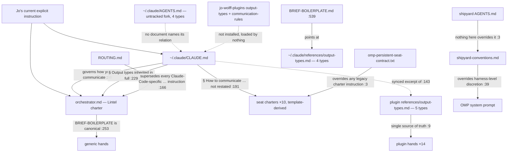

# INVENTORY — the rule system that governs the Marches (Phase 1)

Author: Plumb (they/them), resident seat for the agent-system 2.0 redesign. Written 2026-09-21/22
from four scout enumerations and three reader traces under
`/Users/jowolff/code/agent-system-2.0/.tmp/phase1/` (untracked; the receipts quoted here are
the primary files, the reports are the working set). Brief:
`/Users/jowolff/code/agent-system-2.0/briefs/inventory.md`.

**How to read this file.** Seven sections, each usable alone. Every factual row is a CLAIM
with an absolute path receipt; sizes and mtimes come from `stat`/`wc` runs recorded in the scout
reports. Anything inferred is labeled **GUESS** inline with what would settle it. No quality
opinions — only factual dysfunction (contradiction, dead loader, drifted copy, a mechanism that
does not exist under OMP). Jo's preferences enter in Phase 3, not here.

**The three tiers, as this file uses the words.** *Lintel* — the coordinator, itself an OMP
persistent seat whose home is `/Users/jowolff/.claude` (`/Users/jowolff/.omp/agent/seat-launchers/launch-seat:139-141`).
*Seat* — one of 12 durable named OMP sessions rooted in a home repository
(`/Users/jowolff/.omp/agent/persistent-seats.json:4-52`). *Hand* — a transient subagent spawned by
the `task` tool inside a seat's session; governed by an agent definition, not a charter.

**Provenance vocabulary.** `local` = under `/Users/jowolff/.claude` (Tinker's, a git repo, HEAD
`bf7e2b9`); `omp` = under `/Users/jowolff/.omp` (Tinker's, not a git repo); `plugin` = the
installed newdle plugin `/Users/jowolff/.claude/plugins/cache/contextpress/newdle/0.2.171`
(byte-identical to the source repo's `plugins/newdle` at `2f7e67f` except `.DS_Store`/`.in_use` —
`/Users/jowolff/code/agent-system-2.0/.tmp/phase1/scout-plugins.md:1477-1519`); `repo` = inside a
seat's home repository; `jo-plugins` = `/Users/jowolff/code/jo-wolff-plugins` (Jo's own, remote
`thewolff/jo-wolff-plugins`, HEAD `1f4e7f1`).

**Ten lines, for a reader who stops here.**

1. Every OMP session on this machine loads the same six ambient extensions; `--hook` is `--extension`; `config.yml:1-2 enabledProviders: [claude]` is the one switch that admits the whole `~/.claude` tree (§ 3.1).
2. OMP executes no Claude `hooks` block: all 22 `settings.json` registrations and the plugin's `SubagentStop` entry are dead; `X/newdle-hooks.ts` is the only reason any plugin hook fires (§ 3.1, § 5.1).
3. Hands never see a charter; they see `CLAUDE.md`, the repo `AGENTS.md` chain, three SessionStart digests, and their definition body with `${CLAUDE_PLUGIN_ROOT}` unexpanded (§ 3.4).
4. Every `model:` pin in the 14 hand definitions is discarded; a hand runs at its parent seat's model — measured on all seven hands this phase (§ 3.4). `skills:`, `disallowedTools:`, `effort:` are unread too.
5. The bridge sends no `agent_type`, so `delegation-guard` treats hands as main sessions and every `ask` is a block; the three `Task|Agent` guards read a field OMP never sends and pass everything (§ 3.3).
6. Three documents each claim to be the canonical output-types contract with different type counts (5 / 4 / 5) and rule numbering; `~/.claude/AGENTS.md` is a fourth restatement loaded by nothing (§ 2.2, § 4.1 a/c).
7. The charter template drifted past the 2026-09-11 batch: 11 of 12 charters lack the read-only clause; 1 of 10 names `BRIEF-BOILERPLATE.md`; the template still emits `SendMessage`/`claude agents` (§ 4.1 f).
8. `ROUTING.md` cites eleven line numbers that have all moved, a `config.yml` value that is wrong, and an 11-row seat table for 12 seats (§ 4.2, § 5.3).
9. Always-loaded text per seat runs 18,352 (Tinker) to 38,566 (Wren) o200k tokens; `~/.claude/CLAUDE.md` is 30–63% of every seat; the six nested shipyard seats pay two `AGENTS.md` files (§ 6).
10. What works: launch → registry → mailbox → ack → archive; the roster is consistent across every machine-read surface; cache == source for the plugin; `CLAUDE.md` reaches all three tiers (§ 7).

---

## 1. The map

Grouped by function. Columns: what it is · where · tier(s) it governs · provenance · size
(bytes / words). "Loads?" is deliberately **not** in this section — that is Section 3, per
artifact, with the loader's `file:line`. Exhaustive per-file listings (1,452 rows for
`~/.claude`, 92 for `~/.omp`, 1,538 for the plugins, 421 for seat homes) are in the four scout
reports; this section lists every *governing* artifact individually and collapses only noise.

### 1.1 Identity and charter

| artifact | what | tier | prov | bytes / words |
|---|---|---|---|---:|
| `/Users/jowolff/.claude/agents/orchestrator.md` | Lintel's charter (named as `charter=` at `launch-seat:140`); frontmatter `model: opus` at line 4 | lintel | local | 32,158 / 4,847 |
| `/Users/jowolff/.claude/orchestrator/IDENTITY.md` | Lintel name provenance; says "the charter governs current behavior; this file records where the identity came from" (`:3`) | lintel | local | 2,289 / 334 |
| `/Users/jowolff/.claude/orchestrator/CHARTER.md` | a **45-byte symlink** → `/Users/jowolff/.claude/agents/orchestrator.md` (`ls -la` → `lrwxr-xr-x … -> /Users/jowolff/.claude/agents/orchestrator.md`; an earlier scout row reported it as 0 bytes — wrong, corrected here); a 21.8KB `CHARTER.md.pre-receipt-line-20260824` backup sits beside it | lintel | local | symlink |
| `/Users/jowolff/.claude/orchestrator/README.md` | orientation | lintel | local | 1,491 / 215 |
| `/Users/jowolff/.claude/.ai/tinker-seat-charter.md` + `tinker-seat-memory.md` (+3 charter backups) | Tinker (home `/Users/jowolff/.claude`) | seat | repo(local) | 17.5KB / 1.7KB |
| `/Users/jowolff/code/shipyard/repos/newdle-claude-plugins/.ai/sedge-seat-charter.md` + `-memory.md` | Sedge | seat | repo | see scout-seat-homes:76-99 |
| `/Users/jowolff/code/shipyard/.ai/verge-seat-charter.md` + `-memory.md` | Verge | seat | repo | scout-seat-homes:100-142 |
| `/Users/jowolff/code/shipyard/repos/newdle-web/.ai/wren-seat-charter.md` + `.ai/web-seat-memory.md` | Wren — memory file is `web-seat-memory.md` (`launch-seat:99`), not `wren-seat-memory.md` | seat | repo | scout-seat-homes:143-174 |
| `/Users/jowolff/code/shipyard/repos/data-pipelines/.ai/sluice-seat-charter.md` + `-memory.md` | Sluice | seat | repo | scout-seat-homes:175-339 |
| `/Users/jowolff/code/shipyard/repos/kitchen/.ai/galley-seat-charter.md` + `-memory.md` | Galley | seat | repo | scout-seat-homes:340-358 |
| `/Users/jowolff/code/joseph-gordon-levitt/.ai/levitt-seat-charter.md` + `-memory.md` | Levitt — home is a git repo with **no commits** (`git status -sb` → `No commits yet on main...origin/main [gone]`, scout-seat-homes:20) | seat | repo | scout-seat-homes:359-381 |
| `/Users/jowolff/.codex/AGENTS.md` + `/Users/jowolff/.codex/memories/memory_summary.md` | Codex — charter/memory are Codex-CLI-native files (`launch-seat:147-148`); home is **not a git repo**, no `.ai/` | seat | other | scout-seat-homes:382-401 |
| `/Users/jowolff/code/shipyard/repos/newdle-api/.ai/caspian-seat-charter.md` + `-memory.md` | Caspian | seat | repo | scout-seat-homes:402-418 |
| `/Users/jowolff/code/shipyard/repos/newdle-users/.ai/tron-seat-charter.md` + `-memory.md` | Tron | seat | repo | scout-seat-homes:419-437 |
| `/Users/jowolff/code/agent-system-2.0/.ai/plumb-seat-charter.md` + `-memory.md` | Plumb | seat | repo | 43,985 / 7,217 + 206 words |
| `/Users/jowolff/.claude/skills/new-seat/SKILL.md` (40.8KB) + `references/charter-template.md`, `memory-template.md` | the template every seat charter/memory is generated from; the step-3 rule ladder | seat (as a tier) | local | 40,789 / — |
| `/Users/jowolff/.omp/agent/seat-launchers/omp-persistent-seat-contract.txt` | the seat↔seat messaging contract; delivered as "User Instructions" in every OMP seat session | lintel, seat | omp | 2,269 / 354 |
| `/Users/jowolff/.omp/agent/persistent-seats.json` | the seat roster (12 seats + 1 scheduler `levitt-morning`) | seat | omp | 1,028 / 96 |
| `/Users/jowolff/.claude/agents/transcript-auditor.md` | second local agent definition; `model: opus` at line 4 | hand? | local | 10,230 |
| `/Users/jowolff/.claude/agents/BCKPorchestrator.md.bak`, `orchestrator.md.pre-marches-20260825` | charter backups (62.9KB, 26.6KB) | — | local | backup |

Receipt for the seat→home mapping: `/Users/jowolff/.claude/orchestrator/state/ROUTING.md:188-200`
(11 rows — **Lintel has no row**; its home comes only from `launch-seat:139`) cross-checked against
`launch-seat:95-167` (scout-seat-homes.md:7-24).

### 1.2 Communication rules (how to talk to Jo, voice, references)

| artifact | what | tier | prov | bytes / words |
|---|---|---|---|---:|
| `/Users/jowolff/.claude/CLAUDE.md` | the global rules file: PMDW marker, pronouns, thumbs-up, fold-in-the-cheese, § "How to communicate with Jo", § "References must survive without scrolling", § "Commands you hand to Jo", § "Time-intensive work goes to a subagent", § "Subagent output is the source of truth", § "Output types", HTML presentations, YAML brackets, MCP 401 note | all (every session whose cwd is under `$HOME`) | local | 52,293 / 8,592 |
| `/Users/jowolff/.claude/AGENTS.md` | a second ~8k-word rules file beside it; relationship to `CLAUDE.md` is Section 4 cluster (c) | ? | local | 48,410 / 7,981 |
| `/Users/jowolff/.claude/CLAUDE.md.2026-08-07-current.bak`, `.2026-08-07-pre-comms-rules.bak` | backups (25.2KB, 20.0KB) | — | local | backup |
| `/Users/jowolff/code/jo-wolff-plugins/plugins/communication-rules/` | Jo's published plugin: README, `hooks/hooks.json`, `communication-rules-inject.mjs`, `communication-rules-stop.mjs`, three `checks/*.mjs` (needs-you-first, closing-ask-last, name-the-artifact), `judge/ask.mjs`, `omp/REGISTRATION.md` (mtime 2026-09-21 21:30, "OMP seat adapter … warn-only, unregistered, fail-open") | all (if installed) | jo-plugins | scout-plugins:1544-1579 |
| `/Users/jowolff/code/shipyard/AGENTS.md` | the shipyard workspace rules (§ headings at scout-seat-homes:460-481) — governs every session under `/Users/jowolff/code/shipyard`, i.e. Sedge, Verge, Wren, Sluice, Galley, Caspian, Tron | seat, hand (under shipyard) | repo | 41,583 / 6,290 |
| plugin `skills/humanizer`, `skills/newdle-voice` | voice/wording skills (2 of 63) | all | plugin | — |
| `/Users/jowolff/agent-scratch/`, `/Users/jowolff/Desktop/agent-collaboration-with-adhd-and-autism.md` | referenced by `CLAUDE.md` § "How to communicate with Jo" as the evidence file; not inventoried (outside every root) | — | other | — |

### 1.3 Routing and delegation (who dispatches whom, with what)

| artifact | what | tier | prov | bytes / words |
|---|---|---|---|---:|
| `/Users/jowolff/.claude/orchestrator/state/ROUTING.md` | Lintel's routing state: seat table (`:188-200`), the seven registration surfaces (`:222-256`), model table (Plumb pinned at `:217`) | lintel | local | 69,780 / 10,857 |
| `/Users/jowolff/.claude/orchestrator/state/WORKSTREAMS.md` | workstream register; mtime 2026-08-19 (unchanged for a month) | lintel | local | 8,166 / 1,082 |
| `/Users/jowolff/.claude/orchestrator/contracts/dispatch-ledger.md`, `request-ledger.md` (+1 backup) | what a dispatch/request ledger entry must contain | lintel | local | 10.9KB, 2.5KB |
| `/Users/jowolff/.claude/orchestrator/runbooks/*.md` (7) | `delegation-check`, `relaunch-precompact-adoption-20260915`, `restart-cycle-20260911`, `mid-run-death-recovery`, `agent-reuse-criteria`, `guard-collisions`, `bootstrap` | lintel | local | 3–15KB each |
| `/Users/jowolff/.claude/orchestrator/summon.sh` (+2 backups, `summon.log` 709B mtime 6d), `audit-summon.sh` | Lintel's launch/audit scripts predating the OMP launcher | lintel | local | 16.0KB, 11.2KB |
| plugin `agents/*.md` (14) | the hand tier's governing text: `auditor`, `beefy-builder`, `beefy-research`, `builder`, `changelog`, `checker`, `debugger`, `planner`, `reader`, `research`, `scout`, `storyteller`, `summarizer`, `web-seat`; each pins `model:` at line 4 (fable ×5, opus ×5, haiku ×4) | hand | plugin | 1.4–8.7KB each |
| OMP built-in hand types `reviewer`, `security-reviewer`, `task`, `sonic` | present in Plumb's `task` tool roster with **no definition under any inventoried root** (scouts found none) | hand | omp-binary (GUESS — settled by Section 3) | — |
| plugin `references/shipyard-conventions.md` | routing table, model table, seats, `reader` cost measurements, worktree isolation — injected at session start by `shipyard-conventions-inject.mjs` | lintel, seat | plugin | 24,417 / 3,665 |
| plugin `references/orchestration-patterns.md` | how to brief and run hands | lintel, seat | plugin | 23,825 / 3,701 |
| plugin `references/project-linear-sync.md`, `quick-help.md` | Linear/project routing, help text | seat | plugin | 20.1KB, 3.0KB |
| plugin hooks `delegation-guard.mjs` (31.3KB), `fable-mode-guard.mjs`, `research-agent-guard.mjs`, `worktree-spawn-guard.mjs` | PreToolUse guards on `Task|Agent` (registered `hooks.json:23-56`) | seat→hand boundary | plugin | 31.3 / 15.5 / 8.6 / 11.0KB |
| local hooks `brief-clause-guard.mjs`, `delegation-boundary.mjs` (+test), `request-issue-hand-guard.mjs` | Lintel-side brief/dispatch guards under `/Users/jowolff/.claude/orchestrator/hooks/` | lintel | local | 18.8 / 21.5 / 5.2KB |
| `/Users/jowolff/.claude/CLAUDE.md` § "Time-intensive work goes to a subagent, always", § "Subagent output is the source of truth" | delegation rules at the global level | all | local | (part of 1.2 row) |
| `/Users/jowolff/code/shipyard/AGENTS.md` routing table | per-task-type agent routing for shipyard sessions | seat, hand | repo | (part of 1.2 row) |

### 1.4 Evidence and output types

| artifact | what | tier | prov | bytes / words |
|---|---|---|---|---:|
| plugin `references/output-types.md` | the CLAIM/CITE/GUESS/ACTION/QUESTION/PMDW contract; loaded by every plugin agent definition | all | plugin | 38,224 / 6,298 |
| `/Users/jowolff/.claude/references/output-types.md` | a second copy, mtime 1 month | ? | local | 37,420 / 5,955 |
| `/Users/jowolff/code/shipyard/repos/newdle-claude-plugins/plugins/newdle/references/output-types.md` | the source-repo copy (identical to installed per diff) | — | plugin-src | 38,224 |
| `/Users/jowolff/code/jo-wolff-plugins/plugins/output-types/skills/output-types/reference.md` | a fourth, published copy (19.2KB / 3,180 words — half the size) | all (if installed) | jo-plugins | 19,192 / 3,180 |
| `output-types-incidents.md` ×3 (`/Users/jowolff/.claude/references/`, plugin `references/`, plugin source) | the measured incidents behind rules 7 and 8 | all | local + plugin | 3.7 / 4.3 / 4.3KB |
| `/Users/jowolff/.claude/CLAUDE.md` § "Output types: claim, cite, guess, action, question" | the same contract restated in the global file, with "Synced excerpt" clauses | all | local | (part of 1.2 row) |
| plugin hooks `output-types-inject.mjs` (SessionStart), `output-types-guard.mjs` (Stop + SubagentStop) | injects the labels contract (measured output: 2,810 bytes / 409 words / 681 o200k tokens) and checks the first label + envelope on Stop | all | plugin | 10.0 / 30.9KB |
| plugin `references/hook-scope.md`; `newdle-hooks.json` per repo; `/Users/jowolff/.claude/newdle-output-level.json` (40B), `newdle-hook-mutes.json` (34B) | the on/off and `receipts`/`labels` level machinery for the plugin hooks | all | plugin + local | 12.2KB |
| local hooks `phantom-claim-stop.mjs` (+`phantom-lib.mjs`), `publish-stop.mjs`, `identifier-url-resolver.mjs` (+`.seatnames`, 2 backups), `identifier-link-guard.mjs`, `turn-id.mjs`, `intake-capture.mjs`, `intake-sweep.mjs`, `savepoint-guard.mjs`, `savepoint-restore.sh`, `ledger-write-guard.mjs`, `staging-guard.mjs`, `pr-notify.mjs`, `evals-touch-post.mjs`, `judgement-fit-posttool.sh`, `ctx-history-inject.mjs`, `ctx-search-guard.mjs`, `repair-context.mjs`, `session-gate.mjs`, `shell-lex.mjs`, `plugin-hook-shim.mjs` | Lintel's evidence/ledger guards under `/Users/jowolff/.claude/orchestrator/hooks/` (registered in `settings.json` — Section 3 says whether they fire under OMP) | lintel | local | 1.9–35.8KB each |
| `/Users/jowolff/.omp/agent/extensions/ctx-first-search.ts` | OMP extension: refuses the session's first `grep` until `ctx search` has run once ("a REFUSAL, not an injection", `:2`) | all OMP | omp | 17,334 / 2,480 |
| `/Users/jowolff/.claude/skills/ctx/SKILL.md` | the ctx working-memory skill | all | local | 8,876 |
| `/Users/jowolff/.claude/orchestrator/state/JUDGEMENT.md` (227KB) + 5 `JUDGEMENT-ARCHIVE*.md` (4.6–149KB) | Lintel's judgment ledger | lintel | local | 227,000 / 33,620 |
| `/Users/jowolff/.claude/orchestrator/state/RETRACTIONS.md` (358KB / 57,708 words) and `/Users/jowolff/.claude/state/RETRACTIONS.md` (1.8KB, mtime 2026-08-20) | recorded incorrect claims — **two files of the same name**, 200× apart in size | lintel | local | 358,159 / 57,708 |
| `/Users/jowolff/.claude/orchestrator/state/EXPERIMENTS.md` (+7 backups) | pre-registered machinery experiments | lintel | local | 54,192 / 8,354 |

### 1.5 Verification and hooks (the machinery that enforces, injects, or refuses)

| artifact | what | tier | prov | bytes / words |
|---|---|---|---|---:|
| `/Users/jowolff/.claude/settings.json` | Claude-CLI settings: 22 matcher-level hook registrations across 9 events, 23 command entries, 15 distinct commands (scout-claude-home:1478-1508); `enabledPlugins` = claudex-loop, honcho, newdle, ponytail (`:36`); **no `extensions` key** | Claude CLI sessions | local | 18.8KB |
| `/Users/jowolff/.claude/settings.local.json` | permissions | Claude CLI | local | 1.7KB |
| `/Users/jowolff/.claude/.claude/settings.json` | a project-scoped settings file *inside* `~/.claude` registering 6 plugin hooks through `plugin-hook-shim.mjs` (SessionStart, PreToolUse Bash, Stop ×2, SubagentStop, SessionEnd) | Lintel/Tinker (cwd `~/.claude`) under Claude CLI | local | 1.6KB |
| 14 `settings.json.*` backups at `~/.claude` root (2026-06-13 → 2026-09-11) | history of hook registration changes | — | local | backup |
| plugin `hooks/hooks.json` | 7 PreToolUse, 1 SubagentStop, 1 PreCompact, 6 SessionStart, 3 Stop, 1 SessionEnd registrations (verbatim scout-plugins:616-798) | all (via the bridge) | plugin | 4,760 / 285 |
| plugin `hooks/*.mjs|sh` (19 scripts + `lib/`) | `branch-first-nudge`, `careful-guard` (95.9KB), `compact-continuity` (42.8KB), `compaction-liveness`, `context-pressure`, `delegation-guard`, `fable-mode-guard`, `output-types-guard`, `output-types-inject`, `project-context-inject`, `rebase-before-push`, `recent-activity.sh`, `repo-rules-inject`, `research-agent-guard`, `session-end-reminder.sh`, `session-snapshot`, `shipyard-conventions-inject`, `worktree-spawn-guard`, `wrap-up-nudge.sh` | all | plugin | 2.2–95.9KB |
| `/Users/jowolff/.omp/agent/extensions/*.ts` (6 live) | `newdle-hooks.ts` (77.3KB — the plugin-hook bridge into OMP), `persistent-seat-registry.ts` (53.3KB — `seat_list`/`seat_message`), `ctx-first-search.ts`, `herdr-omp-agent-state.ts` ("installed by herdr", `:1`), `moshi-hooks.ts` ("Auto-generated by moshi-hook", `:1`), `compaction-state-owner.ts` (1.1KB) — plus 16 `.pre-*` backups (13 of them for `newdle-hooks.ts`, 2026-09-10 → 09-17) | all OMP | omp | 1.1–77.3KB |
| `/Users/jowolff/.omp/agent/seat-adapters/newdle-hooks.judgment.ts` (161.3KB, +1 backup) | the seat-specific hook adapter; how it is attached is Section 3 | seat | omp | 161,309 / 24,359 |
| `/Users/jowolff/.omp/agent/config.yml` | OMP config (verbatim scout-omp-home:119-178): `skills.enableClaudeUser: true` (`:35-36`), `modelRoles.default: anthropic/claude-opus-5:medium` (`:43-45`), `compaction.thresholdPercent: 25` (`:48-49`); **no `extensions:` key** | all OMP | omp | 856 / 96 |
| `/Users/jowolff/.omp/config.yml` | **0 bytes** — a second, empty config at the `~/.omp` root | — | omp | 0 |
| `/Users/jowolff/.omp/agent/mcp.json` (+1 backup), `lsp.json` | MCP servers (linear, ctx, WhisprFlow, chrome-devtools), LSP | all OMP | omp | 1.2KB, 678B |
| `/Users/jowolff/.claude/orchestrator/hooks/` — 20 `newdle-hooks.*.ts` / `persistent-seat-registry.*.ts` / `queue-seat-message.envelopev2.ts` variants (9.8–160.7KB) | staged/candidate versions of the OMP extensions living in Lintel's hooks dir (`continuityfresh`, `ext-reconcile`, `extwatchdog`, `hostpayload`, `idguard`, `judgment`, `ledgerguard`, `per-hook-redirect`, `precompact-veto`, `precompact-wiring`, `staleness-banner`, `urlargs`, `urlmachinery`, `mailfix`, `startupreceipt`, `turnfix`) | — (workshop) | local | ≈1.0MB total |
| `/Users/jowolff/.claude/orchestrator/hooks/.retired/`, `.retired-20260915/`, `UNINSTALL.md`, `uninstall.sh` | retirement machinery | — | local | — |
| `/Users/jowolff/.claude/hooks/relative-path-guard.mjs`, `herdr-agent-state.sh` | two hooks outside the orchestrator dir | ? | local | 6.5KB, 3.1KB |
| `/Users/jowolff/.claude/orchestrator/tools/` (≈70 files) | ledger tooling: `request-append.sh`, `request-amend.sh` (36.7KB), `request_issues_reconcile.py`, `issues-ledger-check.*`, `savepoint-generate.py` (40.5KB), `dispatch-spine.py`, `drift-detect.sh`, selftests | lintel | local | — |
| `/Users/jowolff/.claude/orchestrator/evals/` (README 21.8KB, `run-tier1.sh`, `run-tier2.sh`, `pair-check.sh`, `PAIR-EXEMPTIONS.txt`, `scenarios/`, `scenarios-tier2/`, `lib/`) | Lintel's hook regression suite | lintel | local | — |
| plugin `evals/` (README 32.1KB, `run-tier1.sh`, `run-tier2.sh`, `scenarios/`, `scenarios-tier2/`, `routing/`, `fixtures/`, `delegation-guard-baseline/`) | the plugin's hook regression suite | plugin hooks | plugin | — |
| `/Users/jowolff/.omp/agent/seat-launchers/*.test.ts`, `test-launch-seat.zsh`, `test-wake-seat.zsh`, `test-fixtures/herdr` | seat-machinery tests | seat | omp | 2–17.6KB |
| `/opt/homebrew/bin/moshi-hook` | external binary named in 10 `settings.json` hook lines (`:80,92,132,142,178,188,200,231,272,303`) | Claude CLI | machine | — |
| `/Users/jowolff/.claude/plugins/cache/ponytail/ponytail/4.8.4/hooks/ponytail-statusline.sh` | statusline (`settings.json:472`) | Claude CLI | other plugin | — |

### 1.6 Skills

| source | count | how counted | tier | prov |
|---|---:|---|---|---|
| plugin `skills/*/SKILL.md` | **63** | `grep -c` over scout-plugins installed rows | all | plugin |
| `/Users/jowolff/.claude/skills/` | 12 real dirs with `SKILL.md` (`bb-cli` 48.3KB, `ctx`, `html-report`, `jo-deck`, `linear-project-suggest`, `lintel-charter-rollout`, `new-seat` 40.8KB, `orchestrator-evals`, `seat-shutdown`, `sheet-to-linear`, `ubersicht-widget`, +1) · **43 symlinks → `/Users/jowolff/.agents/skills/<name>`** (all targets exist) · 4 empty dirs (`peon-ping-{config,log,toggle,use}`, 0 files) | scout-claude-home Artifacts rows; `ls -d /Users/jowolff/.agents/skills/*/ \| wc -l` → 47 | all | local (+ `~/.agents/skills`, a root the brief did not name) |
| `/Users/jowolff/.omp/agent/skills/seat-shutdown/SKILL.md` | 1 (7.3KB) — a **second `seat-shutdown`** beside `/Users/jowolff/.claude/skills/seat-shutdown/SKILL.md` (8.3KB) | scout-omp-home:92 | seat | omp |
| `/Users/jowolff/code/jo-wolff-plugins/plugins/output-types/skills/output-types/` | 1 | scout-plugins:1580 | all | jo-plugins |
| plugin `SKILLS-MANIFEST.md` | 7.3KB index of the 63 | — | plugin |
| `/Users/jowolff/.claude/settings.json` `skillOverrides` | key present (scout-claude-home:1510) | Claude CLI | local |

Plumb's own session exposes **89 skill names** in its tool prompt (counted 2026-09-22); the union
of the sources above is 118 distinct names after dedupe, 29 hidden — the per-skill enumeration
and the corrections to `:161`, `:168`, `:349` are **§ 8** (appended so lines 1–677 keep their numbers).

### 1.7 State (what persists, where)

| artifact | what | tier | prov | size |
|---|---|---|---|---:|
| `/Users/jowolff/.claude/orchestrator/state/STANDUP.md` | Lintel's memory document (`launch-seat:141`) | lintel | local | 33.8KB / 4,591 |
| `/Users/jowolff/.claude/orchestrator/state/REQUESTS.jsonl` (1.7MB), `.amendments` (4.2MB), `ledger-write-guard.jsonl` (151KB), + a `REQUESTS.jsonl.pre-*` family and `runs/` (≈570 files) | the request ledger and its backups | lintel | local | ≈8MB |
| `/Users/jowolff/.claude/orchestrator/state/JUDGEMENT.md`, `RETRACTIONS.md`, `EXPERIMENTS.md`, `ROUTING.md`, `WORKSTREAMS.md` | see 1.3/1.4 | lintel | local | — |
| `<home>/.ai/<slug>-seat-memory.md` ×11 (Codex: `memories/memory_summary.md`) | seat memory, human-promoted only | seat | repo | scout-seat-homes |
| `<home>/.ai/decision-log/` | committed decision logs; counts per home in scout-seat-homes collapsed rows | seat, hand (via wrap-up) | repo | — |
| `<home>/.ai/session-state.md` | compaction snapshot (written/consumed by plugin hooks) | seat | repo | transient |
| `/Users/jowolff/.claude/.ai/session-handoff.md` (24.1KB), `sol-seats-recipe-20260916.md`, `.ai/omp-compaction-archive/`, `.ai/decision-log/` | Lintel/Tinker handoff material under `~/.claude/.ai` | lintel, tinker | local | — |
| `/Users/jowolff/.omp/agent/seat-sessions/<slug>/` | OMP transcripts per seat: 3,419 files, 957MB total; Tinker 1,130 files / 338MB, Lintel 603 / 153MB, Plumb 12 (scout-omp-home:93-104) | seat | omp | 957MB |
| `/Users/jowolff/.omp/agent/seat-mailboxes/{inbox,acks,archive}` | 1 / 2,929 / 766 files | seat | omp | 2.3MB |
| `/Users/jowolff/.omp/agent/compaction-archive/{lintel,tinker}` | 15 + 2 files | seat | omp | 249KB |
| `/Users/jowolff/.omp/agent/custom-session-files/` | 84 one-line files, each the path of a seat transcript (sample at scout-omp-home:250-256) | seat | omp | 9.5KB |
| `/Users/jowolff/.claude/agent-memory/orchestrator/`, `newdle-builder/` | Claude-CLI agent memory dirs (orchestrator: 6d; newdle-builder: 2mo) | lintel, hand | local | — |
| `/Users/jowolff/.claude/state/REGISTRY.md`, `RETRACTIONS.md`, `pr-notify/` | a second `state/` dir at `~/.claude` root | ? | local | 1.3KB, 1.8KB |
| `/Users/jowolff/.claude/newdle-compaction-heartbeat.ndjson` (40.7KB), `.claude.json` (39.6KB, mtime 3mo), `history.jsonl` (1MB) | Claude-CLI-side state | Claude CLI | local | — |

### 1.8 Seat-lifecycle machinery (the seat tier as a tier)

| artifact | what | tier | prov | bytes / words |
|---|---|---|---|---:|
| `/Users/jowolff/.omp/agent/seat-launchers/launch-seat` (+6 `.pre-*` backups, 2026-09-11 → 09-21) | the launcher: per-seat `case` block `:95-167`, `default_model=` at `:93,142,149,168` | seat | omp | 22,184 / 2,782 |
| `/Users/jowolff/.omp/agent/seat-launchers/wake-seat` | `launch-seat --start` then `check-seat-ready` (verbatim scout-omp-home:195-222) | seat | omp | 564 / 76 |
| `/Users/jowolff/.omp/agent/seat-launchers/check-seat-ready` | readiness poller | seat | omp | 3,130 |
| `/Users/jowolff/.omp/agent/seat-launchers/seat-bin/omp` | the wrapper HerdR runs in the pane (the path whose leading `/` the oh-my-zsh prompt ate on 2026-09-21) | seat | omp | 2,193 |
| `/Users/jowolff/.omp/agent/seat-launchers/queue-seat-message` (+test) | CLI to queue a mailbox envelope | seat | omp | 9,446 |
| `/Users/jowolff/.omp/agent/seat-launchers/persistent-seat-registry.test.ts`, `persistent-seat-registry.candidate*.ts` ×2 | registry tests and two candidate copies | seat | omp | 6.3 / 34.4 / 23.5KB |
| `/Users/jowolff/.omp/agent/skills/seat-shutdown/SKILL.md` and `/Users/jowolff/.claude/skills/seat-shutdown/SKILL.md` | shutdown ritual, two copies (7,299 vs 8,311 bytes) | seat | omp + local | — |
| `/Users/jowolff/.claude/skills/new-seat/` | birth (see 1.1) | seat | local | — |
| `/Users/jowolff/.claude/skills/lintel-charter-rollout/SKILL.md` | 12.0KB, `disable-model-invocation=true` | lintel | local | — |
| `/Users/jowolff/.claude/orchestrator/state/ROUTING.md:222-256` | the seven-surface registration rule | seat | local | — |
| `/Users/jowolff/.omp/agent/extensions/herdr-omp-agent-state.ts`, `/Users/jowolff/.claude/hooks/herdr-agent-state.sh` | HerdR pane-state reporters, one per harness | seat | omp + local | 12.4KB, 3.1KB |
| `/Users/jowolff/.claude/daemon/` (`roster.json` 88B, `attach-journal/`, `dispatch/`, `control.key`), `daemon.log` (67KB, mtime 1w) | a Claude-CLI-era daemon; last written 2026-09-14 | ? | local | — |

### 1.9 Plugin provenance summary (the required column, rolled up)

| provenance | governing artifacts (this map) | what stops if the plugin is uninstalled |
|---|---|---|
| plugin (0.2.171) | 14 hand definitions, 12 references (incl. `output-types.md`, `shipyard-conventions.md`, `orchestration-patterns.md`), 19 hook scripts + `hooks.json`, 63 skills, evals | every plugin-defined hand type; the output-types injection and Stop/SubagentStop guard; session-start conventions injection; compaction continuity/snapshot; delegation/fable/research/worktree guards; 63 skills. Local files that point INTO the plugin — `settings.json:282` (`plugin-hook-shim.mjs output-types-guard.mjs`), `~/.claude/.claude/settings.json` (6 shim lines), `newdle-hooks.ts`/`newdle-hooks.judgment.ts` (resolve `PLUGIN_ROOT`), `launch-seat` — become dangling references. Section 3 receipts each. |
| local (`~/.claude`) | `CLAUDE.md`, `AGENTS.md`, `orchestrator.md`, 47 orchestrator hooks, 12+47 skills, `ROUTING.md`/`STANDUP.md`/ledgers, `new-seat`, evals | unaffected by plugin removal, except the shim registrations above |
| omp (`~/.omp`) | 6 extensions, seat adapter, launcher family, roster, contract, `seat-shutdown` | unaffected in file terms; `newdle-hooks.ts` and the judgment adapter have nothing to bridge |
| repo | 11 charters + memories, 7 shipyard `AGENTS.md`/`CLAUDE.md` chains, decision logs | unaffected |
| jo-plugins | `output-types` skill copy, `communication-rules` plugin | independent of the newdle plugin; not installed in `installed_plugins.json` (`:4-43` lists newdle, ponytail, claudex-loop only) |

---

## 2. The authority graph

Source: `/Users/jowolff/code/agent-system-2.0/.tmp/phase1/reader-B-authority-diff.md` § 1 and
§ Authority graph (quotes verified by the reader with `grep`; line numbers are the reader's
receipts, re-quoted here without broadening).

### 2.1 What each document says about its own rank (verbatim, `path:line`)

| document | its own precedence claim |
|---|---|
| `/Users/jowolff/.claude/CLAUDE.md:79` | "the next section … is the authority on how to communicate here; no other rule in this file should be read as overriding it on that question." |
| `/Users/jowolff/.claude/CLAUDE.md:121` | "When two rule sources contradict each other, name the conflict where you act on it." |
| `/Users/jowolff/.claude/CLAUDE.md:143-145` | "**Synced excerpt.** The canonical text is the section of the same name in the plugin's `references/output-types.md` … **Two divergences from that canonical copy are deliberate**" |
| `/Users/jowolff/.claude/AGENTS.md:142` | same sentence, but "**One deliberate difference**" (zsh only) |
| `/Users/jowolff/.claude/agents/orchestrator.md:58` | "Jo's current explicit instruction outranks this charter. `/Users/jowolff/.claude/CLAUDE.md` governs how you communicate with Jo and the universal safety and evidence rules. This charter governs your role as Lintel." |
| `/Users/jowolff/.claude/agents/orchestrator.md:229` | "You inherit `/Users/jowolff/.claude/CLAUDE.md` section **Output types** in full. Do not restate that taxonomy here; one canonical contract is easier to keep correct." |
| `/Users/jowolff/.claude/agents/orchestrator.md:196` | "`state/REQUESTS.jsonl` remains authoritative; GitHub Issues is a reconciled execution surface, not a second ledger." |
| `/Users/jowolff/.claude/agents/orchestrator.md:253`, `:335` | `state/BRIEF-BOILERPLATE.md` is "the canonical text" appended to generic delegation prompts |
| plugin `references/output-types.md:9-11` | "This file is the single source of truth for the contract. Agent definitions reference it … they do not restate the rules." |
| plugin `references/output-types.md:429-431` | § Commands handed over "**This section is canonical.** The copy in the engineering user's personal `~/.claude/CLAUDE.md` is a synced excerpt" |
| `/Users/jowolff/.claude/references/output-types.md:9-13` | "This file is the canonical contract for agents defined under `/Users/jowolff/.claude/agents/` and for any generic worker spawned from this machine … it changes here and in `/Users/jowolff/.claude/CLAUDE.md` in the same edit." |
| plugin `references/shipyard-conventions.md:3` | "holds only in a session where `newdle@contextpress` is enabled. The shipyard `AGENTS.md` keeps the rules that hold without the plugin; **nothing here overrides it**." |
| plugin `references/shipyard-conventions.md:39`, `:43` | "**This overrides harness-level discretion.**" / "project instructions, which override default behavior" |
| plugin `references/shipyard-conventions.md:96` | "the plugin repo is the canonical source of truth, edited directly." |
| plugin `references/hook-scope.md:84`, `:211-213` | "Nearest wins" / "a mute subtracts and can never add" |
| `/Users/jowolff/code/shipyard/AGENTS.md:46`, `:48`, `:179` | VOICE.md "governs everything written under the Newdle name"; triage tree "the authoritative reference"; "Never push directly to `main`" |
| `/Users/jowolff/.omp/agent/seat-launchers/omp-persistent-seat-contract.txt:3` | "This contract applies whenever a durable named seat runs under OMP. It overrides any legacy charter instruction that names Claude Code's SendMessage tool." |
| `/Users/jowolff/.claude/orchestrator/state/ROUTING.md:166-168` | "This section supersedes every Claude Code-specific launch, discovery, status, and messaging instruction below while the OMP cutover is active." |
| `/Users/jowolff/.claude/orchestrator/state/ROUTING.md:272` | `persistent-seats.json` — "the canonical roster read *fresh on every send*" |
| `/Users/jowolff/.claude/orchestrator/state/ROUTING.md:632` | "Every `newdle:*` agent loads `references/output-types.md` itself. Pasting the contract into their briefs is pure token waste." |
| `/Users/jowolff/.claude/orchestrator/contracts/request-ledger.md:3`, `dispatch-ledger.md:3-6` | each "the canonical machine-readable vocabulary" for its own JSONL; "not interchangeable" |
| charter template `/Users/jowolff/.claude/skills/new-seat/references/charter-template.md:210`, `:332` | "This file is **read-only to you** … a document that can rewrite its own limits is not a limit"; memory "read-only to you — no exceptions" |
| `/Users/jowolff/code/agent-system-2.0/.ai/plumb-seat-charter.md:191-192` | "`/Users/jowolff/.claude/CLAUDE.md` § 'How to communicate with Jo' governs every message you send and is not restated here." |
| `/Users/jowolff/.codex/AGENTS.md:13` | "read `/Users/jowolff/.claude/CLAUDE.md` sections … then follow that contract in full. Its normal exemptions … do not override this file's mandatory leading `PMDW` transport prefix." |
| `/Users/jowolff/code/jo-wolff-plugins/plugins/output-types/skills/output-types/reference.md:1-9` | "Every rule in this plugin exists in exactly one place" (names no other copy) |

### 2.2 Where the claims agree, and where they collide

| question | who claims final say | verdict |
|---|---|---|
| Who may push `main` | shipyard `AGENTS.md:177,179`; template `:361-365` (→ 10 charters); plugin `builder.md:18-19`; `BRIEF-BOILERPLATE.md:440` | **agree** — nobody but Jo. Branch pushes split by tier (seats may push branches/PRs; builders "never … without explicit approval"; boilerplate overrides the builder's "always work on a feature branch") — a tier split stated in each document, not a contradiction. |
| Which text is the output-types contract | plugin `output-types.md:9` (5 types, rules to 11); `~/.claude/references/output-types.md:9-13` (4 types, 8 rules); `CLAUDE.md` via `orchestrator.md:229` (5 types, 8 rules); `~/.claude/AGENTS.md:201` (4 types); `~/.codex/AGENTS.md:13` (→ CLAUDE.md) | **CONFLICT.** Three documents each claim to be canonical for overlapping populations, with different type counts and rule numbering. Who reads which: plugin hands → plugin file (`ROUTING.md:632`); generic hands and `transcript-auditor` → the 4-type local copy (`BRIEF-BOILERPLATE.md:539`, `transcript-auditor.md:165`); Lintel → CLAUDE.md. → § 4 cluster (a), § 5. |
| Which tool messages a seat | contract `:3`; `ROUTING.md:166`; template `:72,:158,:186` (`SendMessage`, `claude agents`); Tron charter `:16,:54` (`claude agents`, `SendMessage` as positive instruction); Plumb `:46-47` (`seat_message`) | **CONFLICT at document level, resolved by a runtime override:** the contract is appended as system prompt to 10 seats (`launch-seat:321`) and outranks the charter text by its own `:3`. The generator still emits the losing instruction (§ 4 cluster (f)). Lintel and Codex do not receive the contract at all (`launch-seat:313-318`; Reader C C-8). |
| Model per seat | `launch-seat:63,142,149,168,176`; `ROUTING.md:236-242`; `config.yml:43-45`; Plumb charter `:58` | **agree** on mechanism (`launch-seat` is it). `ROUTING.md:224-228` misstates `config.yml` (`zai/glm-5.3:high` claimed; file says `anthropic/claude-opus-5:medium`) — Reader C C-6. |
| What a brief must contain | `ROUTING.md:612-614,642`; `orchestrator.md:253,335`; `BRIEF-BOILERPLATE.md:137`; template "Nothing gets dropped" | **agree** for Lintel's briefs. **Gap:** `grep -c BRIEF-BOILERPLATE` over the 10 template-derived charters (run 2026-09-22) → 1 hit (`/Users/jowolff/code/joseph-gordon-levitt/.ai/levitt-seat-charter.md`), 0 in the other nine — nine seats brief hands under a thinner rule than Lintel. |
| How to communicate with Jo | `CLAUDE.md:79`; `orchestrator.md:58`; Plumb `:191-192`; communication-rules plugin README | **agree** among loaded documents; the communication-rules plugin is an unloaded divergent restatement (§ 4 cluster (d)). |
| Where team agents/skills are authored | `shipyard-conventions.md:96,98`; shipyard `AGENTS.md:71` | **agree in text; violated in the tree:** `/Users/jowolff/code/shipyard/repos/data-pipelines/.claude/agents/{auditor,builder,debugger}.md` exist in Sluice's home (scout-seat-homes:185-187) with `model=claude-opus-4-6`/`sonnet`. Whether OMP loads them: § 3. |
| Delegation vs harness discretion | `shipyard-conventions.md:39,43`; the OMP system prompt; `delegation-guard.mjs` | **agree** in text. Machinery: the guard fired on a read-only reader at its 6th distinct path and listed paths touched by *sibling* hands — its streak counter is session-shared (Reader B B-19, observed this session). |
| Seat roster of record | `ROUTING.md:272` (JSON); `ROUTING.md:250-251` (`PERSISTENT_SEATS` env); `registry.ts:257,798-800` | **agree by design, two rosters:** the JSON is read only by the scheduler path (`registry.ts:249-253`); seat-to-seat addressing reads the launch-time env literal (`registry.ts:798-800`). `ROUTING.md:188-200` prose table omits Lintel. |
| Ledgers | `orchestrator.md:196`; `contracts/*.md:3`; `ROUTING.md:581` | **agree.** |
| Charter self-amendment | template `:210` (only Plumb carries it); RETRACTIONS `:541` (Sedge refused a charter edit on the strength of `CLAUDE.local.md`) | **Gap:** 11 of 12 charters have no self-amendment rule; the behaviour exists once, on a different file's authority. |
| Hook precedence | `hook-scope.md:84,211-213` | single source, **agree**; its enforcement description is Claude-CLI `settings.json` registration — OMP path in § 3. |
| Per-agent effort/thinking | `orchestration-patterns.md:414-415` | single source; states a Claude-CLI limit ("Thinking cannot be set per-agent in Claude Code; it is session-wide") while plugin agent frontmatter carries `effort=high`. |

### 2.3 The graph, drawn

Dashed edges are relationships that exist on disk with no sentence in either file describing
them. Section 3 says which nodes are actually loaded into which tier.

---

## 3. What loads versus what exists

Source: `/Users/jowolff/code/agent-system-2.0/.tmp/phase1/reader-A-load-trace.md` (loader table
`:352-391`, findings `:395-431`), cross-checked against Reader C. `OMP_SRC` =
`/Users/jowolff/.bun/install/global/node_modules/@oh-my-pi/pi-coding-agent/src` (package
`@oh-my-pi/pi-coding-agent` 18.2.6 — `readlink -f $(which omp)` → `…/dist/cli.js`; `src/` ships
alongside). `P` = `/Users/jowolff/.claude/plugins/cache/contextpress/newdle/0.2.171`; `X` =
`/Users/jowolff/.omp/agent/extensions`; `O` = `/Users/jowolff/.claude/orchestrator`.

### 3.1 The five gates that decide what an OMP session sees

| gate | receipt | effect |
|---|---|---|
| `--hook` **is** `--extension` | `OMP_SRC/main.ts:1602` `[...(parsed.extensions ?? []), ...(parsed.hooks ?? [])]` | There is no hook loader distinct from the extension loader. A `--hook <file>` must default-export an extension factory (`OMP_SRC/extensibility/extensions/loader.ts:64-66`, error `:415`). A stdin-verdict `.mjs` guard passed as `--hook` cannot load. |
| Ambient extension discovery | `OMP_SRC/discovery/builtin.ts:486`; scan rule `helpers.ts:818-825` (`*.{ts,js}`, `*/index.{ts,js}`, `*/package.json`; one level) | Every `omp` on this machine with no `OMP_PROFILE` loads all six `X/*.ts` regardless of argv. `launch-seat` names three (`:324-326`); ambient adds `ctx-first-search.ts`, `herdr-omp-agent-state.ts`, `moshi-hooks.ts`. Dedupe by resolved path (`loader.ts:568-581`), so the launcher's `--hook X/newdle-hooks.ts` and the ambient copy load once. The 17 `X/*.pre-*` files and `seat-adapters/` are not scanned. |
| `enabledProviders: [claude]` | `/Users/jowolff/.omp/agent/config.yml:1-2`; `OMP_SRC/capability/index.ts:334-343` (`:341` admits `claude`, `:342` admits `claude-plugins`) | The single switch that opts the whole foreign `~/.claude` tree in: `CLAUDE.md`, skills, MCP, `settings.json` (as data), commands, and the marketplace plugin roots. `skills.enableClaudeUser: true` (`config.yml:158-159`) is a redundant legacy opt-in (`discovery/claude.ts:53-60`). Not in `enabledProviders`: `codex` → `~/.codex/AGENTS.md` loads only via `--append-system-prompt` for the Codex seat (`launch-seat:150,:282`). |
| No reader for Claude `hooks` blocks | `OMP_SRC` search `PreToolUse\|SubagentStop\|UserPromptSubmit` → 0; `hooks\.json` → 0; `claude.ts:370-419` reads only `.claude/hooks/pre|post/*`; `claude-plugins.ts:363-407` reads only `<root>/hooks/pre|post/` (neither dir exists) | Every `hooks.*` entry in `/Users/jowolff/.claude/settings.json` (22 registrations, 15 command strings) and every entry in `P/hooks/hooks.json` is inert under OMP **unless an extension re-implements it**. `X/newdle-hooks.ts` is that extension for the plugin manifest (`:35`, re-read per call `:565,:1428`) and for three orchestrator guards by hardcoded path (`:240,:322,:365`). `newdle-hooks.ts:216-232` says so verbatim ("AN OMP SEAT RUNS NONE OF THEM"). |
| `.claude/agents/` skipped by design | `OMP_SRC/task/discovery.ts:13-16` | `orchestrator.md` and `transcript-auditor.md` are never agent types. `orchestrator.md` reaches Lintel only as appended text (`launch-seat:141,:279`). |

### 3.2 Loader table — every governing artifact, its loader, and the four required columns

"Loader" = the `file:line` that reads the artifact into a session; **none** = no loader found under
OMP. Plugin-loss = what happens when `P` is uninstalled.

| artifact | loader | tier(s) | provenance | plugin-loss | portability | OMP-compat |
|---|---|---|---|---|---|---|
| `/Users/jowolff/.omp/agent/seat-launchers/launch-seat` | operator; `seat-bin/omp:6-16` for background seats | lintel, seat | omp | exits 1 (`:20-24`); `:192-194` also fails closed on any of adapter/owner/registry/contract/`mcp.json` | 12 absolute homes `:97-166`; needs `herdr`, `python3`, `bun` | native |
| `/Users/jowolff/.omp/agent/config.yml` | OMP settings; `enabledProviders` gate above | all | omp | — | — | native |
| `X/newdle-hooks.ts` | `--hook` (`launch-seat:324`) + ambient; rebound into every hand (`OMP_SRC/task/executor.ts:3751`) | all | omp | **throws** at `:35/:565/:1428` on manifest read → every tool call in every OMP session on this machine blocked (`runner.ts:1486-1506`); also throws when `NEWDLE_PLUGIN_ROOT` unset (`:32-33`) — any `omp` started outside `launch-seat` fails | 7 absolute paths; `Lintel` hardcoded `:326,:416` | bridge: PreToolUse / Stop / SessionStart / PreCompact / SessionEnd only |
| `X/compaction-state-owner.ts` | `--hook` (`:325`) + ambient | all | omp | — | — | native |
| `X/persistent-seat-registry.ts` | `--extension` (`:326`) + ambient; its tools visible inside hands | all | omp | — | roster literal `:1207`; reads `persistent-seats.json` `:255-258` | native |
| `X/ctx-first-search.ts` | ambient only | all | omp | — | — | native |
| `X/herdr-omp-agent-state.ts` | ambient only; no-op unless `HERDR_ENV=1` (`:18-19`) | seat root sessions | omp (`herdr integration install`) | — | HerdR socket env | native |
| `X/moshi-hooks.ts` | ambient only | all | omp (generated) | — | `/opt/homebrew/bin/moshi-hook` `:16`; macOS socket `:24-28` | native |
| `/Users/jowolff/.omp/agent/seat-adapters/newdle-hooks.judgment.ts` | only via `OMP_SEAT_ADAPTER` (`launch-seat:55`); not ambient | **none of the 5 live seats** (`ps`, Reader C C-23) | omp | as `newdle-hooks.ts` | as `newdle-hooks.ts` | bridge |
| `X/*.pre-*` ×17, `seat-adapters/*.pre-48k-*` | none | — | omp | — | — | — |
| `P/hooks/hooks.json` | `X/newdle-hooks.ts:35` only | all | plugin | gone → adapter throws | — | Claude manifest, bridged |
| `P/hooks/*.mjs`, `*.sh` (21 files) | via manifest, through the bridge | all | plugin | gone | `CLAUDE_PROJECT_DIR` fallbacks; unset under OMP except redirected for `output-types-guard` | Claude stdin protocol, bridged |
| `P/agents/*.md` (14) | `OMP_SRC/task/discovery.ts:127-152` via `listClaudePluginRoots` (`helpers.ts:1136-1215`, reads `installed_plugins.json` `:1158`; `--plugin-dir` roots first `:1316-1319`) | hand | plugin | 14 types vanish; OMP bundled `scout` reappears | `${CLAUDE_PLUGIN_ROOT}` never expanded (`claude-plugins.ts:645-665` applies only to MCP config); env var absent in hands (`printenv`) | `model:` dropped (`discovery.ts:136-152`, `agent-plugin-format.ts:566-571`); `skills:`, `disallowedTools:`, `effort:` unread (`helpers.ts:308-383` reads `autoloadSkills`, `spawns`, `thinkingLevel`) |
| `P/references/*.md` (12) | **none** — pointed at by agent bodies and by injected text; never injected themselves | hand (pointer) | plugin | gone | absolute path in `shipyard-conventions-inject` output | pointer only |
| `P/skills/*` (63) | `OMP_SRC/discovery/claude-plugins.ts:219-232` p70 | all | plugin | gone | — | native |
| `P/SKILLS-MANIFEST.md`, `P/skills/VENDOR.md` | none | — | plugin | — | — | docs |
| `/Users/jowolff/.claude/CLAUDE.md` | `OMP_SRC/discovery/claude.ts:152-185` p80 → `<repo-rules>` (`prompts/system/project-prompt.md:8-16`); copied into hands `executor.ts:3744` | **all three tiers** | local | — | machine-specific by design | native |
| `/Users/jowolff/.claude/AGENTS.md` (292 lines) | **none** — `claude.ts` loads only `CLAUDE.md`; walker skips parents named `.*` (`helpers.ts:728`), including for Lintel/Tinker whose cwd is `~/.claude`; `agents.ts:276-300` reads `.agent(s)/AGENTS.md` | — | local, untracked | — | — | dead |
| `<home>/CLAUDE.local.md` (Sedge, Verge, Wren) | none (`OMP_SRC/discovery` search → 0) | — | repo | — | — | Claude-only |
| `/Users/jowolff/.claude/settings.json` `hooks.*` | none (data only, `claude.ts:500-546`) | — | local | — | 15 absolute commands | Claude-only |
| `settings.json` `enabledPlugins` / `skillOverrides` | `enabledPlugins`: `helpers.ts:1191-1192`; `skillOverrides`: **none** (0 hits) — the four `peon-ping-*` skills it turns off are live in every session | all | local | — | — | partial |
| `/Users/jowolff/.claude/plugins/installed_plugins.json` | `helpers.ts:1158` | all | local (Claude CLI writes) | — | absolute paths; carries a stale `0.2.111` project-scope row for kitchen whose dir is missing (`helpers.ts:1193-1211` pushes it without an existence check; GUESS: warning only for Galley — settle by running discovery with cwd kitchen) | native |
| `/Users/jowolff/.claude/skills/*` (53: 15 dirs, 37 symlinks → `~/.agents/skills`, all resolve) | `claude.ts:190-245` p80 | all | local | — | — | native |
| `/Users/jowolff/.agents/skills/*` (47) | `OMP_SRC/discovery/agents.ts:161-167` p70; real-path dedupe `extensibility/skills.ts:264,:403` | all | local | — | — | native; 10 skills (`beam, brainstorm, editorial-review, harden, nursery, plan, rowing, seeds, taste, translate-to-feature`) reach sessions only by this path |
| `disable-model-invocation: true` skills | honoured: `capability/skill.ts:26-30`, `skills.ts:117` (`hide`) | all | — | — | — | native — explains why `html-report`, `new-seat`, `lintel-charter-rollout`, `handoff`, `triage`, `writing-*` are absent from the model-facing list yet loadable by `skill://` |
| `/Users/jowolff/.omp/agent/skills/seat-shutdown` | `builtin.ts:295-299` p100 — **wins** over the `~/.claude/skills` copy (name dedupe `capability/index.ts:241-249`); live skill list shows the OMP description | all | omp | — | — | native |
| `/Users/jowolff/.claude/skills/seat-shutdown` | shadowed | — | local | — | — | dead; names `claude agents/stop/attach`, `SendMessage` |
| `/Users/jowolff/.claude/agents/orchestrator.md` | `--append-system-prompt` (`launch-seat:141,:279`); live argv pid 8952 | lintel | local | — | absolute | text; its frontmatter (`model: opus`, `initialPrompt:`, `memory: user`, `:1-16`) is inert (Reader C C-15) |
| `/Users/jowolff/.claude/agents/transcript-auditor.md` | only `O/audit-summon.sh:219 exec claude --agent transcript-auditor` | — | local | — | absolute | Claude CLI only |
| seat charters ×10 (`<home>/.ai/<seat>-seat-charter.md`) | **named in the wake prompt only** (`launch-seat:283-284`); Lintel/Codex charters via `--append-system-prompt` (`:279,:282`) | seat | repo | — | absolute homes | text; not a context file; **never copied into hands** (this seat's hands' prompts carried no charter text, reader-A:235) |
| seat memory ×12 (Wren: `web-seat-memory.md`, `:100`, the only off-pattern name) | wake prompt only (`:283`) | seat | repo | — | — | text |
| `/Users/jowolff/.omp/agent/seat-launchers/omp-persistent-seat-contract.txt` | `--append-system-prompt` for 10 seats (`:58,:285`); **not** Lintel/Codex (Reader C C-8) | seat | omp | — | — | native |
| `<repo>/AGENTS.md`, `<repo>/CLAUDE.md` | `agents-md.ts:21` / `claude-md.ts:21` p10, walker `helpers.ts:695-752`; copied to hands `executor.ts:3744` | seat + hand | repo | — | — | native |
| `/Users/jowolff/code/shipyard/AGENTS.md` for the six nested seats | same walker: `scanToHome` (`helpers.ts:704-710`) continues past the sub-repo root because the repo sits under `$HOME`; sub-repos are separate git roots (`git -C …/newdle-api rev-parse --show-toplevel`) | seat + hand (Sedge, Wren, Sluice, Galley, Caspian, Tron) | repo | — | — | native |
| `/Users/jowolff/.codex/AGENTS.md` | `--append-system-prompt` Codex seat only | codex | local | — | — | text |
| `O/hooks/identifier-url-resolver.mjs`, `identifier-link-guard.mjs`, `ledger-write-guard.mjs` | hardcoded `X/newdle-hooks.ts:240,:322,:365` | all / Lintel / Lintel | local | — | absolute | bridged |
| `O/hooks/{brief-clause-guard,phantom-claim-stop,publish-stop,plugin-hook-shim,savepoint-guard,staging-guard,evals-touch-post,intake-capture,pr-notify}.mjs`, `judgement-fit-posttool.sh`, `savepoint-restore.sh`; `/Users/jowolff/.claude/hooks/herdr-agent-state.sh` | `settings.json` only (`:167,:261,:251,:282,:241,:153,:121,:292,:102,:112,:220,:210`) | — | local | — | absolute | **dead under OMP** |
| `O/hooks/delegation-boundary.mjs` (478 L), `request-issue-hand-guard.mjs` (141 L), `ctx-search-guard.mjs`, `ctx-history-inject.mjs`, `turn-id.mjs`, `repair-context.mjs` | none anywhere (0 hits in `settings.json`, `X/*.ts`, adapter, launchers) | — | local | — | absolute | unregistered; `O/runbooks/delegation-check.md:105-114` plans `--hook <path>.mjs`, which cannot load (gate 1 above; file has no `export default`) |
| `/Users/jowolff/code/shipyard/repos/data-pipelines/.claude/agents/{auditor,builder,debugger}.md` | none (`discovery.ts:13-16` skips `.claude/agents`) | — | repo | — | — | dead under OMP |
| OMP bundled agents `reviewer, security-reviewer, task, sonic` (+ shadowed `scout`) | `OMP_SRC/task/agents.ts:42-71` | hand | OMP package | bundled `scout` returns | — | native |
| OMP `task` tool | `OMP_SRC/task/index.ts:492`; input `tasks[].agent` (`task/types.ts:48-56`) — no `subagent_type` | seat → hand | OMP package | — | — | native |

### 3.3 The event bridge — which Claude hook events reach which tier

`X/newdle-hooks.ts` maps OMP events to the plugin manifest's Claude event names. Payload for
`tool_call` is `{hook_event_name:"PreToolUse", session_id, cwd, tool_name, tool_input}`
(`:47-56`) — **no `agent_type`, no `agent_id`**, for seat and hand alike. Tool-name map `:36-45`:
`bash→Bash, read→Read, grep→Grep, find→Glob, write→Write, edit→Edit, task→Task`.

| Claude event in `hooks.json` | OMP source event | seat | hand | notes |
|---|---|---|---|---|
| `SessionStart` | `session_start` → `before_agent_start` hidden message (`:1241-1257`) | yes | yes (child `session_start`) | `output-types-inject`, `shipyard-conventions-inject`, `recent-activity.sh`, `compaction-liveness` observed in hand prompts |
| `PreToolUse` | `tool_call` (`:1428-1462`) | yes | yes (observed: `delegation-guard` refused a reader's `bash`, reader-A:109) | `deny` → block; `ask` → `ctx.ui.confirm` if UI else **block** (`:1448`) — hands have no UI, so every `ask` is a deny; `additionalContext` → **block with the text as reason** (`:1451-1462`, `repo-rules-inject` behaviour change) |
| `Stop` | `session_stop` (`:1259-1280`, `lifecycleInput("Stop")` `:1270`) | yes | GUESS (Reader A G-1): fires in the child session too | Stop-path inputs the guard expects from Claude (`stop_hook_active`, `transcript_path`, `permission_mode`) not supplied (`:58-65`); bridge consumes `stop_hook_active` itself (`:1261`) |
| `SubagentStop` | **never bridged** (`SubagentStop` → 0 hits in `X/newdle-hooks.ts`) | — | — | `output-types-guard.mjs:409` branches on the event: on `Stop` it checks labels + length floor only, **no envelope check, no agent allowlist** (`:431,:513-519`); the `SubagentStop` path (envelope + allowlist + nudge cap `:238-245`) is unreachable. The only other `SubagentStop` route on the machine was `settings.json:282` `plugin-hook-shim.mjs` — dead (gate 4). |
| `PreCompact`, `SessionEnd` | bridged (`compact-continuity`, `session-snapshot`) | yes | — | not traced further (Reader A coverage tier 2) |
| `UserPromptSubmit`, `PostToolUse`, `Notification` | not bridged | — | — | — |

Guards that fire on the tool-name match but cannot see their target:

| guard | reads | under OMP |
|---|---|---|
| `delegation-guard.mjs` | `input.agent_type` (`:432`) → exempts `reader` (`:517`), `scout` (`:478,:561`); `inSubagent` (`:444`) | `agent_type` never sent → every hand is a main session; exemptions lost; check-2 streak counter is session-shared (fired on a reader listing sibling hands' paths, Reader B B-19); `ask` → block |
| `fable-mode-guard.mjs:213`, `research-agent-guard.mjs:100`, `worktree-spawn-guard.mjs` | `tool_input.subagent_type ?? agent_type` | OMP `task` input has `tasks[].agent`; bridge does not translate → target `undefined` → **all three pass through on every dispatch** |
| `careful-guard.mjs:1013` `Glob` branch | tool name `Glob` | OMP's tool is `glob`; bridge maps `find→Glob` only (`:40`) → branch dead |

### 3.4 What a hand actually receives

A hand is a child `AgentSession` in the seat's process with the parent's extensions rebound
(`OMP_SRC/task/executor.ts:3751`), the parent's context files (`:3744`) and skills (`:3745`).

| artifact | reaches a hand? | by what path |
|---|---|---|
| `/Users/jowolff/.claude/CLAUDE.md` | yes | parent `contextFiles` → `<repo-rules>` |
| `<repo>/AGENTS.md` chain (incl. shipyard `AGENTS.md` for nested seats) | yes | same |
| seat charter / memory | **no** | wake prompt only |
| `omp-persistent-seat-contract.txt` | GUESS: no — it is `--append-system-prompt`, not a context file; settle by grepping a hand transcript's system prompt for "persistent-seat communication contract" |
| plugin `references/output-types.md` | **pointed at, not loaded**; pointer is `${CLAUDE_PLUGIN_ROOT}/…` unexpanded | agent body |
| `output-types-inject` digest (681 tok), `shipyard-conventions-inject` (573), `recent-activity` (889) | yes | SessionStart bridge |
| `model:` pin from `P/agents/<type>.md:4` | **no** — dropped; hand runs at the parent's `activeModelPattern` (`config/model-resolver.ts:1216-1247`). Measured this phase: `ScoutPlugins.jsonl`, `ReaderLoadTrace` both `"model":"claude-fable-5-1"` under Plumb | — |
| `tools:` frontmatter | honoured when present (`executor.ts:3358-3360`); unknown names (`WebFetch`, `WebSearch`, `Skill`) silently dropped (`sdk.ts:3344,:3381`) → `research`/`beefy-research`/`auditor` have no web tool | — |
| no `tools:` (scout, checker, summarizer, changelog, web-seat, builders) | full inventory: `read bash edit eval glob grep task hub web_search write yield seat_list seat_message ast_edit debug` + every MCP tool (`ScoutPlugins.jsonl`) — the plugin `scout` shadows OMP's bundled read-only scout (`discovery.ts:161-165`) | — |
| `disallowedTools: Agent` | unread; `task` listed with `spawns:""`; GUESS (Reader A G-2): `resolveSpawnPolicy("")` → disabled, so listed-but-refusing (`spawn-policy.ts:36-48`) | — |
| `skills:` frontmatter | unread; `debugger.md:7 debugging` and `planner.md:7 planning` name skills that exist nowhere anyway | — |

### 3.5 What a seat message traverses (Reader C § 3e, `persistent-seat-registry.ts`)

| hop | mechanism | sync | durable trace |
|---|---|---|---|
| Jo → Lintel | HerdR pane, foreground `exec omp` (`launch-seat:336-358`, `~/.zshrc:156`) | interactive | Lintel transcript; `state/REQUESTS.jsonl` via `tools/request-append.sh` (observed 2026-09-22, last row REQ-548) |
| Lintel → seat | `seat_message` → `inbox/<slug>/<id>.json` (`:379-405`) → 500 ms poll (`:1186`) → `pi.sendMessage` (`:1101-1109`) → ack (`:696-712`) → turn receipt (`:1151-1177`); sender blocks ≤3 s + ≤4 s (`:896-904`); receipts `delivered`/`queued`/`acted` (`:126-136`; contract text names only two, Reader C C-7) | async | `acks/<id>.json`, `acks/<id>.turn.json`, `archive/<id>.json`; recipient transcript entry with `display:false` (`:1078-1083,:1104`) — **nothing on the recipient's screen** (C-11) |
| seat → hand → seat | `task` tool, in-process | in-session | subagent transcript under the seat session dir; `yield` payload |
| seat → Lintel | `seat_message`, mirrored | async | as above |
| Lintel → Jo | Lintel's pane; durable only if Lintel edits `STANDUP.md`/`JUDGEMENT.md` by hand (observed `edit` calls) | interactive | `state/STANDUP.md`, `state/JUDGEMENT.md` |

One round trip = 6 hops, 2 of them mailbox hops, each mailbox hop leaving 3 files and blocking the
sender ≤7 s. Plumb is exempt from the two mailbox hops by ruling (`ROUTING.md:202-209`). Seat-to-seat
addressing reads the launch-time `OMP_PERSISTENT_SEAT_NAMES` literal (`:798-800`), not
`persistent-seats.json` (scheduler and `queue-seat-message` CLI only, `:249-258,:868-871`, C-9).
Mailbox state: 11 inbox dirs (no `plumb/` — no seat has ever messaged Plumb), 2,316 acks + 612 turn
receipts + 766 archived, unbounded by design (`:402-404,:714-720`, C-10).

### 3.6 Observed this phase (tool records)

- `delegation-guard` refused a `reader` hand's `bash` twice with "should go through the `scout`
  subagent" (reader-A:109, :291) — the hand-tier exemption is lost (§ 3.3).
- `ctx-first-search` refused the first `grep` of every hand until a `ctx search` ran (reader-A:224).
- All seven hands this phase ran as `claude-fable-5-1` despite `haiku`/`opus` pins in their
  definitions (§ 3.4) — the model plan approved for this phase was not enforceable by agent type.
- Reader C: the wake failure of 2026-09-21 (oh-my-zsh update prompt ate the leading `/` of the
  `seat-bin/omp` path) is consistent with `launch-seat:392-411,:423` doing nothing to suppress
  shell init and checking readiness only by foreground pgid (C-5). GUESS (C G-8): consistent, not
  reproduced; settle with `herdr pane run` on a fresh tab with `zstyle ':omz:update' mode disabled`.

---

## 4. Duplication and drift

Every cluster below was diffed by Reader B (`reader-B-authority-diff.md` § 2; commands and hashes
inline there). Verdict vocabulary: **identical** (byte-equal), **deliberately divergent** (a
sentence in one copy says so), **drifted** (differs with no sentence explaining why).

### 4.1 The clusters

| # | cluster | copies | verdict | receipt |
|---|---|---|---|---|
| (a) | `output-types.md` | plugin cache 0.2.171 · plugin source repo · marketplace checkout · `~/.claude/references/` · jo-wolff-plugins `reference.md` | cache == source == marketplace (**identical**, md5 `325edc31…`, last commit `c7f4e7af` 2026-09-15). `~/.claude/references/` copy: **deliberately divergent by its own text** (`:17-29` "disagrees with the plugin's copy on purpose") **and drifted past its own alarm** — `diff -u` 56 hunks / 366+ 404−; it is the **4-type** contract (no QUESTION), rules numbered 7/8 vs plugin 10/11; its own drift detector at `:35-43` expected sha `85cb3529…`, the marketplace file now hashes `2e82e1d4…`, no reconciliation since mtime 2026-08-20. jo-wolff-plugins copy: a **third restatement** (310 lines, half the size) naming no other copy. | reader-B:129-152 |
| (a') | `output-types-incidents.md` | `~/.claude/references/` · plugin · plugin source | plugin == source. Local **drifted**: headed "Rule 7/8" and "Supplement to … CLAUDE.md"; plugin headed "Rule 10/11" and "Supplement to `${CLAUDE_PLUGIN_ROOT}/…`". `CLAUDE.md:246,250` point at the local (7/8) copy; deleting it breaks those two lines. | reader-B:152 |
| (b) | § Commands you hand to Jo | `CLAUDE.md:141-168` · plugin `output-types.md:427-521` | same rule-zero + 7 headings in the same order; the **two declared divergences are present and are the only path/shell differences** (`agent-scratch` absolute vs `~`; zsh vs shell-neutral). Prose: **516 of ~1,100 words differ** ("Jo" → "the engineering user", re-wrapped, plugin 16% longer). Verdict: deliberately divergent on the declared points, drifted in wording everywhere else — "synced excerpt" describes rules, not text. | reader-B:154-162 |
| (c) | `CLAUDE.md` vs `~/.claude/AGENTS.md` | `/Users/jowolff/.claude/CLAUDE.md` (tracked, last commit `a17f7ad` 2026-09-11) · `/Users/jowolff/.claude/AGENTS.md` (**untracked** — `git ls-files` → not known; mtime 2026-09-09) | **drifted; no sentence in either file names the other.** `diff` → 21 hunks. AGENTS.md is the 4-type contract; says "One deliberate difference"; sends handover scripts to a repo `.tmp/` (contradicting `CLAUDE.md:155` and the injected conventions); cites `/Users/jowolff/.Codex/references/output-types-incidents.md` (path does not exist — a `claude→Codex` search-and-replace); adds `## Code search` (ast-grep MCP — `grep -c ast-grep` over `/Users/jowolff/.omp/agent/mcp.json` and `/Users/jowolff/.claude.json` → 0; `/Users/jowolff/.claude/mcp.json` absent; not mounted) and a `## Agent skills` tail pointing at `docs/agents/*.md`. Whether Lintel/Tinker load it: § 3. | reader-B:164-177 |
| (d) | § How to communicate with Jo / § References | `CLAUDE.md:81-139` (16 + 8 bold rules) · `/Users/jowolff/code/jo-wolff-plugins/plugins/communication-rules/` (8-rule subset with enforcement hooks; HEAD `1f4e7f1` 2026-09-21) | **different artifact, not a copy**; the enforced rule set and the loaded rule set are different sets. Plugin not installed (`installed_plugins.json` keys: claudex-loop, newdle, ponytail); its `omp/REGISTRATION.md:3-5` says "Status: **unregistered** … loaded by nothing". | reader-B:179-183 |
| (e) | `seat-shutdown` skill | `/Users/jowolff/.omp/agent/skills/seat-shutdown/SKILL.md` (113 lines, mtime 09-11 02:06) · `/Users/jowolff/.claude/skills/seat-shutdown/SKILL.md` (159 lines + `reference.md`, mtime 09-11 00:52) | **deliberately divergent** — OMP copy `:10` "Use this override for persistent seats running in OMP under HerdR. The Claude Code source remains the rollback implementation." Both carry `name: seat-shutdown`; the Claude copy names `claude agents`/`SendMessage` ×4. This session's skill list shows the OMP copy's description; Resolved in § 3.2: the `~/.omp/agent/skills` copy wins (builtin p100 > claude p80, `OMP_SRC/capability/index.ts:241-249`). | reader-B:185-194; reader-C:328 |
| (f) | charter template vs 12 live charters | `/Users/jowolff/.claude/skills/new-seat/references/charter-template.md` (459 lines, 15 `##`, 31-id RULE INVENTORY `:40-72`) · 12 charters | **drifted, generationally.** Template `##` present: Plumb 15/15 · Tron 14 · Sluice/Galley/Levitt/Caspian 13 · Tinker/Sedge/Verge 12 · Wren 5 · Lintel 2 · Codex 0. RULE INVENTORY probes hit: Plumb 31/31 · Tron 27 · six seats 26 · Sedge/Verge 23 · Wren 15 · Lintel/Codex 1. `## Your charter is not yours to amend` (template `:208`) absent from **11 of 12**; `## Aged documentation is re-derived; boundaries are not` (`:266`) absent from 10 of 12. The template grew after the 2026-09-11 batch; no charter was regenerated. **The template itself still emits Claude-CLI mechanisms**: `:72,:78,:158,:186` (`SendMessage`, `claude agents`); Tron carries them verbatim at `:16` and `:54` as positive instructions; the other 09-11 charters were hand-patched. | reader-B:218-241 (12-row table) |
| (g) | `newdle-hooks.judgment.ts` | `/Users/jowolff/.omp/agent/seat-adapters/` (2,900 lines, mtime 09-18) · `/Users/jowolff/.claude/orchestrator/hooks/` (2,891 lines, mtime 09-16) | **drifted, again**: 3 hunks / 19 lines — the live copy relocated the compaction archive to `~/.omp/agent/compaction-archive/<slug>` (`// DEC-039`, 2026-09-18); the orchestrator copy still writes `<repo>/.ai/omp-compaction-archive`. `RETRACTIONS.md:4604-4616` (2026-09-17) records syncing exactly these two files "because a future install from it would have silently reverted Tinker's watchdog repair" — the hazard that retraction closed is open again. Whether either is loaded: § 3 (Reader C C-23: no live seat runs the judgment adapter). | reader-B:196-205 |
| (h) | `RETRACTIONS.md` / `EXPERIMENTS.md` | `/Users/jowolff/.claude/orchestrator/state/RETRACTIONS.md` (358,159 B, 148 entries, 2026-08-19 → 09-19) · `/Users/jowolff/.claude/state/RETRACTIONS.md` (1,766 B, **one** 2026-08-21 entry) | **not copies** — the small file's single entry ("neither had written anything before you stopped them" was not checked and was false) does not appear in the big one (`grep -c` → 0). `/Users/jowolff/.claude/state/EXPERIMENTS.md` does not exist. **GUESS** (Reader B G-3): `~/.claude/state/` is an abandoned earlier location of the state layer; settle with `stat -f %SB` birth times (git log returned nothing — untracked). | reader-B:207-216 |
| (i) | seat roster | `ROUTING.md:188-200` · `persistent-seats.json` · `launch-seat:62,66,95-169` · `test-launch-seat.zsh` · `persistent-seat-registry.ts:1208` | 12 seats consistent in every machine-read surface; **the ROUTING.md prose table has 11 rows (no Lintel)**. Registry tool description is current (lists Plumb). | reader-B:243-260; reader-C:193-203 |
| (j) | `CLAUDE.md` at shipyard repos | six `<repo>/CLAUDE.md` files of 10–11 bytes | identical one-word pointers (content at scout-seat-homes rows); the rules live in each repo's `AGENTS.md`. Not drift. | measure-seats-detail.md |
| (k) | `persistent-seat-registry.ts` candidates | live `~/.omp/agent/extensions/` · `seat-launchers/persistent-seat-registry.candidate*.ts` ×2 · `orchestrator/hooks/persistent-seat-registry.{mailfix,startupreceipt,turnfix}.ts` · `.pre-plumb-20260921T220142` backup | six files under one name across three directories; not diffed (only (g) was in the reader's scope). **GUESS**: the `orchestrator/hooks/` variants are staged candidates never installed — settle with `md5sum` against the live file and `RETRACTIONS.md` entries naming them. | scout-claude-home Artifacts; scout-omp-home:52-56 |
| (l) | `newdle-hooks.ts` staged variants | live (1,467 lines) · 16 `.pre-*` backups in `~/.omp/agent/extensions/` · 13 `newdle-hooks.<tag>.ts` in `orchestrator/hooks/` (9.8–131KB) | the `orchestrator/hooks/` set is a workshop of candidate builds (`continuityfresh`, `ext-reconcile`, `extwatchdog`, `hostpayload`, `idguard`, `ledgerguard`, `per-hook-redirect`, `precompact-veto`, `precompact-wiring`, `staleness-banner`, `urlargs`, `urlmachinery`, plus `judgment`); none is loaded by `launch-seat` (which names only `newdle-hooks.ts`, `compaction-state-owner.ts`, `persistent-seat-registry.ts` — `launch-seat:57-61`). | scout-claude-home; reader-C:224 |

### 4.2 Line-reference drift (documents citing lines that moved)

| citing document | cites | actual | receipt |
|---|---|---|---|
| `ROUTING.md:250` | `launch-seat:18` for `PERSISTENT_SEATS` | `:62` | reader-C:16,196 |
| `ROUTING.md:257` | `launch-seat:22` for `usage()` | `:66` | reader-C:17,197 |
| `ROUTING.md:252` | `persistent-seat-registry.ts:292-294` reads the allowlist | `configuredSeatNames()` `:798-800` | reader-C:68 |
| `ROUTING.md:266` | `persistent-seat-registry.ts:452` tool description | `:1208` | reader-C:20 |
| `ROUTING.md:229-231` | `test-launch-seat.zsh` assertions codex :44, sluice :55, galley :65, levitt :75, caspian :280, tron :304, "Lintel assertion at :24" | :36, :47, :57, :67, :274, :298; **no model assertion exists in the Lintel block** `:19-26` (only `:129`) | reader-C:42,199 |
| `ROUTING.md:224-228` | `config.yml:42` `modelRoles.default: zai/glm-5.3:high` | `config.yml:43-45` `anthropic/claude-opus-5:medium` | reader-C:86 |
| `new-seat/SKILL.md:166` | launch-seat "greps the charter at its `[2/6] charter` gate" | `grep -c '\[[0-9]/6\]'` → launch-seat 0, `launch-template.sh` 6 | reader-C:50,144 |
| `launch-seat:43-45` | every seat loads `newdle-hooks.judgment.ts` | no such file in `~/.omp/agent/extensions/` (only a `.pre-48k` backup); live `ps` shows all five seats on stock `newdle-hooks.ts` | reader-C:401 |
| `orchestrator.md:282` | "Measured 2026-08-24" | `RETRACTIONS.md:1626-1643` is dated 2026-08-25 | reader-B:275 |
| contract L13 | two receipt states (`delivered`/`queued`) | `registry.ts:126-136` defines three (`acted`) | reader-C:77,297 |
| `summon.log` | "agent definition ok (961 lines)" | `orchestrator.md` is 474 lines | reader-C:100 |
| `CLAUDE.md:143-145` vs `~/.claude/AGENTS.md:142` | "Two divergences" vs "One deliberate difference" | — | reader-B:28 |

**Method note.** Every `file:line` in this section was produced by a reader's `grep`/`sed`
this session and quoted without re-derivation; per the CLAUDE.md citation rule they are report
receipts, valid on 2026-09-22, and will rot the next time any of these files is edited.

---

## 5. Dead and orphaned

"Dead" = exists, is named or registered somewhere, and no OMP loader executes it. "Orphaned" =
exists and nothing names it. "Stale reference" = a live document names a thing that is not there.
Receipts are Reader A/B/C finding ids (`.tmp/phase1/reader-*.md`) plus the loader table in § 3.2.

### 5.1 Dead (registered, never executed under OMP)

| artifact | registered by | why dead | receipt |
|---|---|---|---|
| 12 orchestrator hooks: `O/hooks/{brief-clause-guard,phantom-claim-stop,publish-stop,plugin-hook-shim,savepoint-guard,staging-guard,evals-touch-post,intake-capture,pr-notify}.mjs`, `judgement-fit-posttool.sh`, `savepoint-restore.sh`, `~/.claude/hooks/herdr-agent-state.sh` | `/Users/jowolff/.claude/settings.json:167,261,251,282,241,153,121,292,102,112,220,210` | OMP has no reader for Claude `hooks` blocks (§ 3.1 gate 4). `phantom-claim-stop.mjs:7` says "THIS GUARD BLOCKS"; `publish-stop.mjs:3-6` was the auto-run of `sync-to-lintel.sh`/`backup-state.sh`; `plugin-hook-shim.mjs` was the only `SubagentStop` route for `output-types-guard`. | A-1, A-14 |
| `/Users/jowolff/.claude/.claude/settings.json` (6 shim lines) | itself | same gate | scout-claude-home |
| `SubagentStop` entry in `P/hooks/hooks.json` | plugin manifest | never bridged by `X/newdle-hooks.ts` | A-2 |
| `/Users/jowolff/.claude/AGENTS.md` (292 lines, untracked, mtime 2026-09-09) | nothing — no document names it (§ 2.3 dashed edge) | no loader (`helpers.ts:728` skips `.claude` parent); drifted 103 lines from `CLAUDE.md` | A-11, B-5 |
| `<home>/CLAUDE.local.md` (Sedge 1,782 B, Verge 818 B, Wren 1,295 B) | Claude CLI convention | no OMP loader | A-33 |
| `/Users/jowolff/.claude/skills/seat-shutdown/` (159 lines + `reference.md`) | `~/.claude/skills` p80 | name-shadowed by the `~/.omp/agent/skills` copy p100 | A-16, C-12 |
| `/Users/jowolff/.claude/agents/transcript-auditor.md`; `O/summon.sh:290`, `O/audit-summon.sh:219`; `~/.zshrc:158 assay()` | Claude CLI `--agent` | `.claude/agents` skipped by OMP; both scripts `exec claude` | A-13, C-16 |
| `O/runbooks/mid-run-death-recovery.md`, `O/runbooks/bootstrap.md` | Lintel charter | recover from `~/.claude/projects/**/subagents/*.jsonl` (Claude layout); key on `summon.sh` and retired `LEDGER.jsonl` (`orchestrator.md:332`) | C-17 |
| `orchestrator.md:1-16` frontmatter (`model: opus`, `initialPrompt:`, `memory: user`) | Claude agent format | appended as text; model comes from `launch-seat:142` | C-15 |
| `model:` line 4, `skills:`, `disallowedTools:`, `effort:` in all 14 `P/agents/*.md` | plugin | unread by OMP (§ 3.4) | A-3, A-4 |
| `WebFetch`, `WebSearch`, `Skill` in `tools:` of `research`, `beefy-research`, `auditor` | plugin | no such OMP tool; silently dropped | A-6 |
| `settings.json` `skillOverrides` | local | unread; the four `peon-ping-*` skills it disables are live | A-27 |
| `/Users/jowolff/code/shipyard/repos/data-pipelines/.claude/agents/{auditor,builder,debugger}.md` | repo | `.claude/agents` skipped | § 3.2; scout-seat-homes:185-187 |
| `new-seat` skill birth path: `claude --bg --name`, `claude agents --json`, `SendMessage`, `claude stop`, per-repo `.tmp/launch-seat.sh` exec'ing `claude` | `/Users/jowolff/.claude/skills/new-seat/SKILL.md:10,:303,:327,:501-526,:549-552`; `references/launch-template.sh:48,:231,:252,:254-255` | `ROUTING.md:285-288` forbids exactly these; the OMP launch path is `launch-seat`, which the skill does not name at the registration step | C-1, C-2 |
| charter template `charter-template.md` Claude-CLI instructions (`SendMessage`, `claude agents`) `:72,:158,:186` | `new-seat` | overridden at runtime by the contract (`:3`) for 10 seats; still emitted into every new charter | B cluster (f) |
| `X/newdle-hooks.ts` `extensionReconciliation()` digest path (`OMP_SEAT_EXT_DIGEST`, `:1114`) | itself | never exported by `launch-seat` (0 hits) → banner is name/mtime only | A-22 |

### 5.2 Orphaned (nothing names or loads it)

| artifact | receipt |
|---|---|
| `O/hooks/delegation-boundary.mjs` (478 L), `request-issue-hand-guard.mjs` (141 L), `ctx-search-guard.mjs`, `ctx-history-inject.mjs`, `turn-id.mjs`, `repair-context.mjs`; libs `intake-sweep.mjs`, `phantom-lib.mjs`, `shell-lex.mjs` — 0 registrations anywhere; `O/runbooks/delegation-check.md:3-4` "NOTHING IS INSTALLED AND NOTHING IS REGISTERED" | A-15 |
| `O/hooks/session-gate.mjs` — imported only by the unregistered `request-issue-hand-guard.mjs:15` | A-5c table |
| `/Users/jowolff/.omp/agent/seat-adapters/newdle-hooks.judgment.ts` (2,900 L) and `O/hooks/newdle-hooks.judgment.ts` (2,891 L) — attached to no live seat; the two copies differ by 3 hunks (`DEC-039` archive path) after `RETRACTIONS.md:4604-4616` recorded syncing them | A-23, B-8, C-23 |
| 13 `O/hooks/newdle-hooks.<tag>.ts` candidate builds (9.8–131 KB), 16 `X/newdle-hooks.ts.pre-*`, 6 `launch-seat.pre-*`, 2 `persistent-seat-registry.candidate*.ts`, 3 `O/hooks/persistent-seat-registry.{mailfix,startupreceipt,turnfix}.ts` | B clusters (k), (l); scout-omp-home:52-56 |
| `/Users/jowolff/.claude/state/RETRACTIONS.md` (1,766 B, one 2026-08-21 entry absent from the orchestrator ledger), `state/REGISTRY.md`, `state/pr-notify/` | B-9 |
| `/Users/jowolff/.claude/daemon/` (`roster.json` 88 B, `attach-journal/`, `dispatch/`, `control.key`), `daemon.log` 67 KB, last write 2026-09-14 | § 1.8 |
| `/Users/jowolff/code/jo-wolff-plugins/plugins/{output-types,communication-rules}` — not in `installed_plugins.json` (keys: claudex-loop, newdle, ponytail); `communication-rules/omp/REGISTRATION.md:3-5` "Status: unregistered … loaded by nothing" | B-3, B-6 |
| `P/SKILLS-MANIFEST.md`, `P/skills/VENDOR.md` — 0 code readers | A-32 |
| `/Users/jowolff/.omp/config.yml` (0 bytes — not the agent config) | scout-omp-home |
| `O/state/WORKSTREAMS.md` — last write predates the OMP cutover (scout-claude-home mtime row) | GUESS: superseded by `STANDUP.md`; settle by grepping Lintel's last three sessions for `WORKSTREAMS.md` |
| `~/.omp/agent/seat-sessions/` (957 MB) is not a `ctx` source (`ctx sources --all` lists Pi and Claude dirs only) while `ctx-first-search.ts` gates `grep` on a ctx query — seat transcripts are invisible to the gate that cites them | C-14 |

### 5.3 Stale references (live documents naming things that moved or are gone)

| document | says | actual | receipt |
|---|---|---|---|
| `launch-seat:43-45` | every seat loads `newdle-hooks.judgment.ts` from `extensions/` | file is under `seat-adapters/`; no live seat carries it | A-23, C-23 |
| `ROUTING.md:224-228` | `config.yml:42` `modelRoles.default: zai/glm-5.3:high`, "the model Lintel itself runs on" | `config.yml:43-45` `anthropic/claude-opus-5:medium`; Lintel argv `--model anthropic/claude-opus-5` | C-6 |
| `ROUTING.md:250,:257,:252,:266,:229-231` | eleven `launch-seat` / registry / test line refs | all moved; "Lintel assertion at :24" does not exist | C-2; § 4.2 |
| `ROUTING.md:188-200` seat table | 11 rows | 12 seats (no Lintel row) | B cluster (i) |
| `new-seat/SKILL.md:166` | launch-seat "greps the charter at its `[2/6] charter` gate" | 0 such gates in `launch-seat`; 6 in the Claude `launch-template.sh` | C-3 |
| `O/runbooks/delegation-check.md:105-114` | register by `--hook <path>/delegation-boundary.mjs` | `--hook` requires an extension factory export; the file has none | A-15 |
| contract L13 | receipt states `delivered`/`queued` | registry emits three (`acted`, `:126-136`) | C-7 |
| `orchestration-patterns.md:414-415` | "Thinking cannot be set per-agent in Claude Code" | plugin frontmatter carries `effort:`; OMP reads `thinkingLevel` instead — neither key matches the other | B § 2.2 |
| `P/agents/debugger.md:7`, `planner.md:7` | `skills: debugging` / `planning` | no such skill directory anywhere | A-12 |
| `installed_plugins.json` | project-scope `newdle@contextpress 0.2.111` for kitchen | install dir missing | A-26 |
| `~/.claude/AGENTS.md:…` | `/Users/jowolff/.Codex/references/output-types-incidents.md` | path does not exist | B cluster (c) |
| `CLAUDE.md:246,250` | local `output-types-incidents.md` "Rule 7/8" | plugin copy is "Rule 10/11"; the local copy is the one cited | B cluster (a') |
| `~/.claude/references/output-types.md:35-43` drift detector | expected marketplace sha `85cb3529…` | file hashes `2e82e1d4…`; no reconciliation since 2026-08-20 | B cluster (a) |
| `O/summon.log` | "agent definition ok (961 lines)" | `orchestrator.md` is 474 lines | C-16 |

---

## 6. Size and reading cost

**Method.** `/Users/jowolff/code/agent-system-2.0/.tmp/phase1/measure-seats.sh` (run 2026-09-22,
output `measure-seats.out`, per-file detail `measure-seats-detail.md`). Per seat it sums:
`/Users/jowolff/.claude/CLAUDE.md` (global — every session whose cwd is under `$HOME`), the
charter and memory named at `/Users/jowolff/.omp/agent/seat-launchers/launch-seat:98-167`, any
`AGENTS.md` / `CLAUDE.md` / `CLAUDE.local.md` at the seat's home directory, and the **real output**
of the three plugin SessionStart injectors captured by running them
(`.tmp/phase1/inject-output-types-inject.mjs.out` 2,810 B, `inject-shipyard-conventions-inject.mjs.out`
2,301 B, `inject-recent-activity.out` 3,204 B — the recent-activity one varies per repo; the
agent-system-2.0 run is used for every seat as a stand-in, labeled GUESS below).
Tokens are **o200k_base via `js-tiktoken`** (`.tmp/phase1/tokcount.mjs`); no Anthropic tokenizer is
on disk, so every token figure here is an approximation — bytes and words are exact (`wc`).

**Not counted, deliberately:** the harness system prompt and tool descriptions (OMP's own, not a
governing artifact of Jo's); skill *descriptions* in the tool prompt (≈90 names — count in 1.6);
the `omp-persistent-seat-contract.txt` (454 tokens, delivered as "User Instructions" — add it to
every OMP row); MCP server instructions; and parent-directory `AGENTS.md` for seats nested under `/Users/jowolff/code/shipyard`.

**Corrections applied after the § 3 loader trace** (the script's raw output in
`measure-seats.out` predates them; the tables below are corrected):
- `/Users/jowolff/.claude/AGENTS.md` (10,791 tok) is loaded by nothing under OMP (§ 3.2) —
  removed from Lintel and Tinker.
- `CLAUDE.local.md` is not loaded by OMP (§ 3.2) — removed from Sedge (431), Verge (195), Wren (317).
- The walker continues past a nested repo root to `$HOME` (`helpers.ts:704-710`), so Sedge, Wren,
  Sluice, Galley, Caspian and Tron also load `/Users/jowolff/code/shipyard/AGENTS.md` (9,647) and
  `/Users/jowolff/code/shipyard/CLAUDE.md` (5) — added (+9,652 tokens, +41,594 bytes, +6,291 words, +2 files).

### 6.1 Per-seat always-loaded text (o200k tokens, approximate)

| seat | files | bytes | words | tokens | largest single component |
|---|---:|---:|---:|---:|---|
| **Wren** | 10 | 165,597 | 25,481 | **38,566** | `CLAUDE.md` 11,630 · shipyard `AGENTS.md` 9,647 · `web-seat-memory.md` **6,331** (the only memory file over 1,100) · charter 4,798 |
| Sedge | 10 | 152,865 | 23,689 | 35,388 | `CLAUDE.md` 11,630 · shipyard `AGENTS.md` 9,647 · repo `AGENTS.md` 8,029 · charter 3,619 |
| Caspian | 10 | 146,655 | 22,832 | 34,247 | `CLAUDE.md` 11,630 · shipyard `AGENTS.md` 9,647 · charter 7,754 · repo `AGENTS.md` 2,691 |
| Galley | 10 | 139,733 | 21,350 | 32,263 | `CLAUDE.md` 11,630 · shipyard `AGENTS.md` 9,647 · charter 5,090 · repo `AGENTS.md` 3,443 |
| Tron | 8 | 137,629 | 21,520 | 31,847 | `CLAUDE.md` 11,630 · shipyard `AGENTS.md` 9,647 · charter 8,067 |
| Sluice | 10 | 132,758 | 20,746 | 30,624 | `CLAUDE.md` 11,630 · shipyard `AGENTS.md` 9,647 · charter 5,366 · repo `AGENTS.md` 1,527 |
| Lintel | 6 | 126,554 | 19,160 | 29,931 | `CLAUDE.md` 11,630 · `STANDUP.md` 9,470 · `orchestrator.md` 6,688 |
| Verge | 8 | 124,721 | 19,642 | 28,723 | `CLAUDE.md` 11,630 · shipyard `AGENTS.md` 9,647 · charter 4,988 |
| Levitt | 6 | 104,939 | 16,713 | 24,835 | `CLAUDE.md` 11,630 · charter **9,969** (largest seat charter after Plumb's) |
| Plumb | 6 | 105,919 | 17,145 | 24,534 | `CLAUDE.md` 11,630 · charter 10,462 |
| Tinker | 6 | 80,351 | 12,869 | 18,352 | `CLAUDE.md` 11,630 · charter 4,153 |
| Codex | 6 | 75,665 | 11,881 | 17,151 | `CLAUDE.md` 11,630 · `~/.codex/AGENTS.md` 1,850 · `memory_summary.md` 1,528 (**GUESS**: Codex CLI does not read `~/.claude/CLAUDE.md` at all; if so its real figure is ≈5,500) |

Per-file rows for every seat (pre-correction): `/Users/jowolff/code/agent-system-2.0/.tmp/phase1/measure-seats-detail.md`. Byte/word columns for corrected rows are arithmetic on those per-file rows (shipyard `AGENTS.md` 41,583 B / 6,290 w; `~/.claude/AGENTS.md` 48,410 B / 7,981 w; `CLAUDE.local.md` 1,782/264, 818/115, 1,295/193).

### 6.2 The shared components (what every seat pays)

| component | bytes | words | tokens | who pays |
|---|---:|---:|---:|---|
| `/Users/jowolff/.claude/CLAUDE.md` | 52,293 | 8,592 | 11,630 | all 12 (the largest single item in 11 of 12 totals; 28–68% of each) |
| `/Users/jowolff/.claude/AGENTS.md` | 48,410 | 7,981 | 10,791 | **nobody** — no OMP loader (§ 3.2) |
| `/Users/jowolff/code/shipyard/AGENTS.md` | 41,583 | 6,290 | 9,647 | Verge and the six nested seats (Sedge, Wren, Sluice, Galley, Caspian, Tron) — 7 of 12 |
| three SessionStart injections (measured output) | 8,315 | 1,130 | 2,143 | all 12 |
| `omp-persistent-seat-contract.txt` | 2,269 | 354 | 454 | all 12 (not in the table totals) |
| plugin `references/output-types.md` | 38,224 | 6,298 | 8,821 | **not** loaded by seats at start — the injector emits a 681-token digest; the full file is what each *hand* definition tells the hand to read |
| the 12 `<home>/CLAUDE.md` files at shipyard repos | 10–11 | 1 | 4–5 | six seats; each is a one-word pointer (`@AGENTS.md`-style — content at scout-seat-homes) |

### 6.3 Hand tier (per dispatch)

| hand | definition tokens | + `output-types.md` read (8,821) | model pinned (`:4`) |
|---|---:|---:|---|
| builder | 2,071 | 10,892 | opus |
| beefy-builder | 1,401 | 10,222 | fable |
| reader | 1,379 | 10,200 | opus |
| auditor | 1,325 | 10,146 | fable |
| research | 1,208 | 10,029 | opus |
| beefy-research | 1,207 | 10,028 | fable |
| debugger | 828 | 9,649 | opus |
| web-seat | 815 | 9,636 | opus |
| planner | 773 | 9,594 | fable |
| storyteller | 751 | 9,572 | fable |
| scout | 747 | 9,568 | haiku |
| checker | 425 | 9,246 | haiku |
| summarizer | 396 | 9,217 | haiku |
| changelog | 314 | 9,135 | haiku |

Plus, for every hand: the parent's `CLAUDE.md`/`AGENTS.md` chain, copied in (`OMP_SRC/task/executor.ts:3744`, § 3.4) —
11,630 tokens minimum, up to 21,282 for a hand of a nested shipyard seat. The `model pinned` column is
what the definition says; under OMP it is discarded (§ 3.4). The reference files a hand may be pointed at by its definition:
`shipyard-conventions.md` 5,545 tokens, `orchestration-patterns.md` 5,322 tokens.

### 6.4 The largest files a seat is told to read on demand (not at start)

| file | bytes | words | tokens |
|---|---:|---:|---:|
| `/Users/jowolff/.claude/orchestrator/state/RETRACTIONS.md` | 358,159 | 57,708 | ≈80k (GUESS — not tokenized; 1.4 tok/word ratio from the files above) |
| `/Users/jowolff/.claude/orchestrator/state/JUDGEMENT.md` | 227,000 | 33,620 | ≈47k (same GUESS) |
| `/Users/jowolff/.claude/orchestrator/state/ROUTING.md` | 69,780 | 10,857 | ≈15k (same GUESS) |
| `/Users/jowolff/.claude/orchestrator/state/EXPERIMENTS.md` | 54,192 | 8,354 | ≈12k (same GUESS) |
| `/Users/jowolff/.claude/skills/new-seat/SKILL.md` | 40,789 | — | — |
| `/Users/jowolff/.claude/references/output-types.md` | 37,420 | 5,955 | 8,892 |

**Factual observation, no opinion attached:** after correction the spread is 18,352 (Tinker) to
38,566 (Wren), and `/Users/jowolff/.claude/CLAUDE.md` alone is 30–63% of every seat's load. The six
nested shipyard seats each pay two `AGENTS.md` files (parent 9,647 + own 1,527–8,029) before their charter.

---

## 7. What works

Factual: mechanisms observed doing what their own text says, with the receipt. No quality opinion.

| mechanism | evidence |
|---|---|
| Seat launch, per-seat model, session dir, plugin root, three named extensions | `launch-seat:94-170,:319-327`; live `ps` shows five seats with the argv the launcher builds (reader-A:115) |
| Ambient extension load + real-path dedupe | six `X/*.ts` load once each; `loader.ts:568-581` (A § 1b) |
| Plugin-cache pin to newest version by `sort -V` | `launch-seat:18-19`; 0.2.171 is what every live seat carries |
| Mailbox: envelope → poll → inject → ack → turn receipt → archive, with three receipt states | `persistent-seat-registry.ts:379-405,:696-720,:1101-1177,:126-136`; 2,316 acks / 612 turn receipts / 766 archives on disk (C-9…C-11) |
| `seat_list` / `seat_message` roster is current (lists Plumb); `persistent-seats.json` and `OMP_PERSISTENT_SEAT_NAMES` agree on 12 names | `registry.ts:1207`; `launch-seat:59`; B cluster (i) |
| Surfaces 2↔7 of the seven-surface registration rule have a divergence test | `queue-seat-message.test.ts:77-93`; `persistent-seat-registry.test.ts:20-205`; `test-launch-seat.zsh` (C-4 — the other surfaces are untested) |
| Plugin cache == plugin source == marketplace checkout for `output-types.md` and `output-types-incidents.md` | md5 `325edc31…`; B cluster (a) |
| `disable-model-invocation` honoured | `capability/skill.ts:26-30`; hidden skills still reachable by `skill://` (A § 4a) |
| `/Users/jowolff/.claude/CLAUDE.md` reaches all three tiers | `claude.ts:152-185`; `executor.ts:3744`; every hand prompt this phase carried `<repo-rules>` |
| Repo `AGENTS.md` chain reaches seat and hands, including the shipyard parent for nested seats | `helpers.ts:695-752`; A-35 |
| SessionStart injections (`output-types-inject`, `shipyard-conventions-inject`, `recent-activity.sh`, `compaction-liveness`) fire for seat and hands | observed in every hand prompt (A § 3d) |
| PreToolUse bridge for `Bash`-matched guards (`careful-guard`, `rebase-before-push`) and `Read/Edit/Write` (`repo-rules-inject`, `branch-first-nudge`) | `newdle-hooks.ts:36-45,:1428-1462`; A § 5a |
| `ctx-first-search` gate: one `ctx search` per session unlocks `grep` | observed on every hand and on this seat (decision log 2026-09-21) |
| `compaction-state-owner.ts` + `compact-continuity` snapshot: this seat compacted once during Phase 1 (252,235 tokens) and resumed from the snapshot | this session's post-compaction banner; `.ai/.gitignore` written by the hook |
| `output-types-guard` on the `Stop` path: label checks + length floor, never blocks | `P/hooks/output-types-guard.mjs:102-110,:431` (envelope path unreachable, § 3.3) |
| `--append-system-prompt` delivers the contract to 10 seats and the charter to Lintel/Codex | `launch-seat:279,:282,:285`; live argv |
| OMP bundled `reviewer`, `security-reviewer`, `task`, `sonic` available as hand types alongside the 14 plugin types | `task/agents.ts:42-71`; this session's tool description lists all 18 |
| Charter read-only rule and memory human-promotion rule present in Plumb's charter (the only charter carrying the template's `## Your charter is not yours to amend`) | `charter-template.md:210`; B cluster (f) |

---

## 8. Per-skill enumeration (Phase 2 addendum, 2026-09-22)

Generated by `/Users/jowolff/code/agent-system-2.0/scripts/enum-skills.sh` (tracked; the
script is the receipt — rerun it to regenerate `.tmp/phase2/plumb-F-skills.md`). Roots scanned,
with the priority `INVENTORY.md:339-350` gives each: `/Users/jowolff/.omp/agent/skills` p100 ·
`/Users/jowolff/.claude/skills` p80 · `P/skills` p70 ·
`/Users/jowolff/.claude/plugins/cache/claudex-loop/claudex-loop/2.1.0/skills` p70 (the second
installed plugin, `installed_plugins.json` keys `claudex-loop@claudex-loop`, `newdle@contextpress`,
`ponytail@ponytail`; ponytail ships no skills) · `/Users/jowolff/.agents/skills` p70.

**Corrections to Phase 1 rows, from the fresh listing (`ls -la`, 2026-09-22T17:34Z):**

- `:161` is wrong and `:347` is right: `/Users/jowolff/.claude/skills` holds **15 real dirs with
  `SKILL.md` + 37 symlinks (all resolve) = 52 entries, 0 empty dirs**. The "4 empty dirs
  `peon-ping-*`" belong to `/Users/jowolff/.agents/skills/peon-ping-{config,log,toggle,use}`
  (no `SKILL.md` there); the `~/.claude/skills/peon-ping-*` dirs each hold a `SKILL.md` **symlink
  into `/opt/homebrew/opt/peon-ping/libexec/skills/<name>/SKILL.md`** — a sixth skill source,
  Homebrew, invisible to `find -type f`.
- `:349` lists `new-seat` among hidden skills: **wrong** — `new-seat/SKILL.md` frontmatter has no
  `disable-model-invocation` key and the skill is in the block. The hidden set is the 29 named in
  the table (`html-report`, `lintel-charter-rollout`, `handoff`, `triage`, `writing-*` are in it;
  `new-seat` is not).
- `:168`'s "112 candidates" undercounted: 63 (newdle) + 4 (claudex-loop) + 52 (`~/.claude`) + 47
  (`~/.agents`) + 1 (omp) = 167 entries → 118 distinct names after name dedupe.
- The block includes four skills from a root Phase 1 never named: `claudex-loop`, `claudex-route`,
  `codex-build`, `codex-review` (claudex-loop plugin 2.1.0).

**Shadowing and drift between roots (name dedupe, highest priority wins):**

| name | winner | shadowed copy | relationship |
|---|---|---|---|
| `seat-shutdown` | `/Users/jowolff/.omp/agent/skills/seat-shutdown/SKILL.md` (p100) | `/Users/jowolff/.claude/skills/seat-shutdown/SKILL.md` | deliberately divergent (§ 4.1 e) |
| `handoff` | `/Users/jowolff/.agents/skills/handoff/SKILL.md` via `~/.claude/skills/handoff` symlink (p80) | `P/skills/handoff/SKILL.md` | plugin copy never loads; both hidden anyway |
| `html-report` | `/Users/jowolff/.claude/skills/html-report/` (real dir, p80, mtime 2026-07-01) | `/Users/jowolff/.agents/skills/html-report/` (mtime 2026-07-24) | `diff -rq` → **differs**; the older copy wins |
| `jo-deck` | `/Users/jowolff/.claude/skills/jo-deck/` (real dir, p80, mtime 2026-06-18) | `/Users/jowolff/.agents/skills/jo-deck/` (mtime 2026-07-24) | `diff -rq` → **differs**; the older copy wins |
| `bb-cli`, `linear-project-suggest`, `sheet-to-linear`, `ubersicht-widget` | `~/.claude/skills/<name>/` real dir (p80) | `~/.agents/skills/<name>/` | `diff -rq` → identical |
| 37 names | `~/.claude/skills/<name>` → symlink → `~/.agents/skills/<name>` | — | one file, two paths; real-path dedupe (`skills.ts:264,:403`) |

**Every name, winner, hidden flag, in-block flag** (`P` = plugin cache 0.2.171; "claude" winner
with a `/Users/jowolff/.agents/skills/…` path means the `~/.claude/skills` symlink resolved there):

| name | winner root | winner `SKILL.md` | shadowed copy | `disable-model-invocation` | in block |
|---|---|---|---|---|---|
| api-and-interface-design | plugin | `P/skills/api-and-interface-design/SKILL.md` | — | absent | y |
| ask-matt | claude | `/Users/jowolff/.agents/skills/ask-matt/SKILL.md` | — | true | n |
| bb-cli | claude | `/Users/jowolff/.claude/skills/bb-cli/SKILL.md` | — | absent | y |
| boot | plugin | `P/skills/boot/SKILL.md` | — | true | n |
| browser-testing-with-devtools | plugin | `P/skills/browser-testing-with-devtools/SKILL.md` | — | absent | y |
| canary | plugin | `P/skills/canary/SKILL.md` | — | absent | y |
| careful | plugin | `P/skills/careful/SKILL.md` | — | absent | y |
| ci-cd-and-automation | plugin | `P/skills/ci-cd-and-automation/SKILL.md` | — | absent | y |
| claude-handoff | claude | `/Users/jowolff/.agents/skills/claude-handoff/SKILL.md` | — | true | n |
| claudex-loop | claudex | `/Users/jowolff/.claude/plugins/cache/claudex-loop/claudex-loop/2.1.0/skills/claudex-loop/SKILL.md` | — | absent | y |
| claudex-route | claudex | `/Users/jowolff/.claude/plugins/cache/claudex-loop/claudex-loop/2.1.0/skills/claudex-route/SKILL.md` | — | absent | y |
| code-review | claude | `/Users/jowolff/.agents/skills/code-review/SKILL.md` | — | absent | y |
| code-review-and-quality | plugin | `P/skills/code-review-and-quality/SKILL.md` | — | absent | y |
| code-simplification | plugin | `P/skills/code-simplification/SKILL.md` | — | absent | y |
| codebase-design | claude | `/Users/jowolff/.agents/skills/codebase-design/SKILL.md` | — | absent | y |
| codex-build | claudex | `/Users/jowolff/.claude/plugins/cache/claudex-loop/claudex-loop/2.1.0/skills/codex-build/SKILL.md` | — | absent | y |
| codex-review | claudex | `/Users/jowolff/.claude/plugins/cache/claudex-loop/claudex-loop/2.1.0/skills/codex-review/SKILL.md` | — | absent | y |
| context-engineering | plugin | `P/skills/context-engineering/SKILL.md` | — | absent | y |
| council | plugin | `P/skills/council/SKILL.md` | — | absent | y |
| create-skill | plugin | `P/skills/create-skill/SKILL.md` | — | false | y |
| ctx | claude | `/Users/jowolff/.claude/skills/ctx/SKILL.md` | — | absent | y |
| debugging-and-error-recovery | plugin | `P/skills/debugging-and-error-recovery/SKILL.md` | — | absent | y |
| deprecation-and-migration | plugin | `P/skills/deprecation-and-migration/SKILL.md` | — | absent | y |
| diagnosing-bugs | claude | `/Users/jowolff/.agents/skills/diagnosing-bugs/SKILL.md` | — | absent | y |
| documentation-and-adrs | plugin | `P/skills/documentation-and-adrs/SKILL.md` | — | absent | y |
| domain-modeling | claude | `/Users/jowolff/.agents/skills/domain-modeling/SKILL.md` | — | absent | y |
| doubt-driven-development | plugin | `P/skills/doubt-driven-development/SKILL.md` | — | absent | y |
| frontend-ui-engineering | plugin | `P/skills/frontend-ui-engineering/SKILL.md` | — | absent | y |
| gaslight | plugin | `P/skills/gaslight/SKILL.md` | — | false | y |
| git-guardrails-claude-code | claude | `/Users/jowolff/.agents/skills/git-guardrails-claude-code/SKILL.md` | — | absent | y |
| git-workflow-and-versioning | plugin | `P/skills/git-workflow-and-versioning/SKILL.md` | — | absent | y |
| grill-me | claude | `/Users/jowolff/.agents/skills/grill-me/SKILL.md` | — | true | n |
| grill-with-docs | claude | `/Users/jowolff/.agents/skills/grill-with-docs/SKILL.md` | — | true | n |
| grilling | claude | `/Users/jowolff/.agents/skills/grilling/SKILL.md` | — | absent | y |
| handoff | claude | `/Users/jowolff/.agents/skills/handoff/SKILL.md` | P/skills/handoff, /Users/jowolff/.agents/skills/handoff | true | n |
| html-report | claude | `/Users/jowolff/.claude/skills/html-report/SKILL.md` | — | true | n |
| humanizer | plugin | `P/skills/humanizer/SKILL.md` | — | absent | y |
| idea-refine | plugin | `P/skills/idea-refine/SKILL.md` | — | absent | y |
| impeccable | plugin | `P/skills/impeccable/SKILL.md` | — | absent | y |
| implement | claude | `/Users/jowolff/.agents/skills/implement/SKILL.md` | — | true | n |
| implement-spec | claude | `/Users/jowolff/.agents/skills/implement-spec/SKILL.md` | — | true | n |
| improve-codebase-architecture | claude | `/Users/jowolff/.agents/skills/improve-codebase-architecture/SKILL.md` | — | true | n |
| incremental-implementation | plugin | `P/skills/incremental-implementation/SKILL.md` | — | absent | y |
| interview-me | plugin | `P/skills/interview-me/SKILL.md` | — | absent | y |
| jo-deck | claude | `/Users/jowolff/.claude/skills/jo-deck/SKILL.md` | — | absent | y |
| linear-project-suggest | claude | `/Users/jowolff/.claude/skills/linear-project-suggest/SKILL.md` | — | absent | y |
| lintel-charter-rollout | claude | `/Users/jowolff/.claude/skills/lintel-charter-rollout/SKILL.md` | — | true | n |
| loop-me | claude | `/Users/jowolff/.agents/skills/loop-me/SKILL.md` | — | true | n |
| migrate-to-shoehorn | claude | `/Users/jowolff/.agents/skills/migrate-to-shoehorn/SKILL.md` | — | absent | y |
| new-seat | claude | `/Users/jowolff/.claude/skills/new-seat/SKILL.md` | — | absent | y |
| newdle-a11y-audit | plugin | `P/skills/newdle-a11y-audit/SKILL.md` | — | absent | y |
| newdle-audits | plugin | `P/skills/newdle-audits/SKILL.md` | — | false | y |
| newdle-code-review | plugin | `P/skills/newdle-code-review/SKILL.md` | — | absent | y |
| newdle-code-simplify | plugin | `P/skills/newdle-code-simplify/SKILL.md` | — | absent | y |
| newdle-cso | plugin | `P/skills/newdle-cso/SKILL.md` | — | absent | y |
| newdle-eval-authoring | plugin | `P/skills/newdle-eval-authoring/SKILL.md` | — | false | y |
| newdle-fable-mode | plugin | `P/skills/newdle-fable-mode/SKILL.md` | — | true | n |
| newdle-land-and-deploy | plugin | `P/skills/newdle-land-and-deploy/SKILL.md` | — | absent | y |
| newdle-nightly-prioritize | plugin | `P/skills/newdle-nightly-prioritize/SKILL.md` | — | false | y |
| newdle-nightly-recap | plugin | `P/skills/newdle-nightly-recap/SKILL.md` | — | false | y |
| newdle-performance-audit | plugin | `P/skills/newdle-performance-audit/SKILL.md` | — | absent | y |
| newdle-project-plan | plugin | `P/skills/newdle-project-plan/SKILL.md` | — | false | y |
| newdle-project-spec | plugin | `P/skills/newdle-project-spec/SKILL.md` | — | false | y |
| newdle-project-sync | plugin | `P/skills/newdle-project-sync/SKILL.md` | — | false | y |
| newdle-project-sync-mastra | plugin | `P/skills/newdle-project-sync-mastra/SKILL.md` | — | true | n |
| newdle-qa | plugin | `P/skills/newdle-qa/SKILL.md` | — | absent | y |
| newdle-research | plugin | `P/skills/newdle-research/SKILL.md` | — | true | n |
| newdle-responsive-audit | plugin | `P/skills/newdle-responsive-audit/SKILL.md` | — | absent | y |
| newdle-security-audit | plugin | `P/skills/newdle-security-audit/SKILL.md` | — | absent | y |
| newdle-seo-audit | plugin | `P/skills/newdle-seo-audit/SKILL.md` | — | absent | y |
| newdle-smoke-test | plugin | `P/skills/newdle-smoke-test/SKILL.md` | — | absent | y |
| newdle-storybook-stories | plugin | `P/skills/newdle-storybook-stories/SKILL.md` | — | absent | y |
| newdle-sync-product-docs | plugin | `P/skills/newdle-sync-product-docs/SKILL.md` | — | false | y |
| newdle-triple-check | plugin | `P/skills/newdle-triple-check/SKILL.md` | — | absent | y |
| newdle-voice | plugin | `P/skills/newdle-voice/SKILL.md` | — | false | y |
| observability-and-instrumentation | plugin | `P/skills/observability-and-instrumentation/SKILL.md` | — | absent | y |
| orchestrator-evals | claude | `/Users/jowolff/.claude/skills/orchestrator-evals/SKILL.md` | — | absent | y |
| peon-ping-config | claude | `/Users/jowolff/.claude/skills/peon-ping-config/SKILL.md` | — | absent | y |
| peon-ping-log | claude | `/Users/jowolff/.claude/skills/peon-ping-log/SKILL.md` | — | absent | y |
| peon-ping-toggle | claude | `/Users/jowolff/.claude/skills/peon-ping-toggle/SKILL.md` | — | absent | y |
| peon-ping-use | claude | `/Users/jowolff/.claude/skills/peon-ping-use/SKILL.md` | — | absent | y |
| performance-optimization | plugin | `P/skills/performance-optimization/SKILL.md` | — | absent | y |
| planning-and-task-breakdown | plugin | `P/skills/planning-and-task-breakdown/SKILL.md` | — | absent | y |
| prototype | claude | `/Users/jowolff/.agents/skills/prototype/SKILL.md` | — | absent | y |
| quorum | plugin | `P/skills/quorum/SKILL.md` | — | absent | y |
| ready-for-production | plugin | `P/skills/ready-for-production/SKILL.md` | — | absent | y |
| research | claude | `/Users/jowolff/.agents/skills/research/SKILL.md` | — | absent | y |
| resolving-merge-conflicts | claude | `/Users/jowolff/.agents/skills/resolving-merge-conflicts/SKILL.md` | — | absent | y |
| retro | claude | `/Users/jowolff/.agents/skills/retro/SKILL.md` | — | true | n |
| scaffold-exercises | claude | `/Users/jowolff/.agents/skills/scaffold-exercises/SKILL.md` | — | absent | y |
| seat-shutdown | omp | `/Users/jowolff/.omp/agent/skills/seat-shutdown/SKILL.md` | /Users/jowolff/.claude/skills/seat-shutdown | false | y |
| security-and-hardening | plugin | `P/skills/security-and-hardening/SKILL.md` | — | absent | y |
| setup-matt-pocock-skills | claude | `/Users/jowolff/.agents/skills/setup-matt-pocock-skills/SKILL.md` | — | true | n |
| setup-pre-commit | claude | `/Users/jowolff/.agents/skills/setup-pre-commit/SKILL.md` | — | absent | y |
| setup-ts-deep-modules | claude | `/Users/jowolff/.agents/skills/setup-ts-deep-modules/SKILL.md` | — | true | n |
| sheet-to-linear | claude | `/Users/jowolff/.claude/skills/sheet-to-linear/SKILL.md` | — | true | n |
| shipping-and-launch | plugin | `P/skills/shipping-and-launch/SKILL.md` | — | absent | y |
| source-driven-development | plugin | `P/skills/source-driven-development/SKILL.md` | — | absent | y |
| spec-driven-development | plugin | `P/skills/spec-driven-development/SKILL.md` | — | absent | y |
| split-to-prs | plugin | `P/skills/split-to-prs/SKILL.md` | — | absent | y |
| tdd | claude | `/Users/jowolff/.agents/skills/tdd/SKILL.md` | — | absent | y |
| teach | claude | `/Users/jowolff/.agents/skills/teach/SKILL.md` | — | true | n |
| test-driven-development | plugin | `P/skills/test-driven-development/SKILL.md` | — | absent | y |
| to-questionnaire | claude | `/Users/jowolff/.agents/skills/to-questionnaire/SKILL.md` | — | true | n |
| to-spec | claude | `/Users/jowolff/.agents/skills/to-spec/SKILL.md` | — | true | n |
| to-tickets | claude | `/Users/jowolff/.agents/skills/to-tickets/SKILL.md` | — | true | n |
| triad | plugin | `P/skills/triad/SKILL.md` | — | absent | y |
| triage | claude | `/Users/jowolff/.agents/skills/triage/SKILL.md` | — | true | n |
| ubersicht-widget | claude | `/Users/jowolff/.claude/skills/ubersicht-widget/SKILL.md` | — | absent | y |
| using-agent-skills | plugin | `P/skills/using-agent-skills/SKILL.md` | — | absent | y |
| wait-what | claude | `/Users/jowolff/.agents/skills/wait-what/SKILL.md` | — | true | n |
| wayfinder | claude | `/Users/jowolff/.agents/skills/wayfinder/SKILL.md` | — | true | n |
| wizard | claude | `/Users/jowolff/.agents/skills/wizard/SKILL.md` | — | absent | y |
| wrap-up | plugin | `P/skills/wrap-up/SKILL.md` | — | false | y |
| writing-beats | claude | `/Users/jowolff/.agents/skills/writing-beats/SKILL.md` | — | true | n |
| writing-for-agents | claude | `/Users/jowolff/.agents/skills/writing-for-agents/SKILL.md` | — | absent | y |
| writing-fragments | claude | `/Users/jowolff/.agents/skills/writing-fragments/SKILL.md` | — | true | n |
| writing-shape | claude | `/Users/jowolff/.agents/skills/writing-shape/SKILL.md` | — | true | n |

